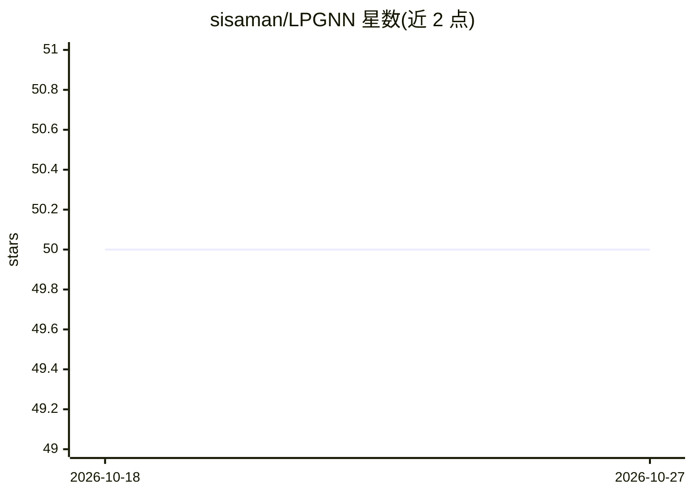

# sisaman/LPGNN

⭐ 50 · Jupyter Notebook · MIT · 推送 2026-10-21 · [GitHub](https://github.com/sisaman/LPGNN) · [官网](https://arxiv.org/abs/2006.05535) · 个人维护

**ACM CCS'21 本地差分隐私图神经网络论文官方实现**

论文《Locally Private Graph Neural Networks》(ACM CCS 2021) 的官方 PyTorch 实现：提出基于局部差分隐私(LDP)的架构无关 GNN 学习框架，通过本地隐私机制扰动并压缩节点特征，供中心服务器近似邻域聚合；在 GNN 前置 KProp 去噪层，并提出针对 privatized 噪声标签的鲁棒学习算法。面向希望复现实验或在此基础上研究的科研人员，依赖由 uv 管理，另提供 DGL 分支实现。

## 筛选速览

| 维度 | 判定 | 备注 |
|---|---|---|
| AI 角色 | `ai-native` | 本体是模型或模型工具 |
| 许可风险 | `permissive` | MIT |
| 部署形态 | `None` |  |
| 模型依赖 | — | README 未给出锁定关系 |
| 硬件要求 | — | 无带数字的原话,不猜 |
| 安装摩擦 | `medium` | 含编译或系统依赖之一 |
| 成熟度 | — | 结构信号不足 |

## 能力要点

- 基于局部差分隐私(LDP)的架构无关 GNN 训练框架
- KProp 多跳聚合去噪层前置设计
- 面向 privatized 噪声标签的鲁棒节点分类算法
- 一键复现论文全部实验（数据集自动下载）

## 适用场景

- 复现 ACM CCS 2021 论文的节点分类实验
- 研究图神经网络的本地差分隐私机制
- 在 LDP 框架下训练带去噪层的 GNN 模型

## 场景标签

`科研工具` · 领域:学习与行业

## 证据(README 行号)

> L3: This repository is the official implementation of the paper:
> L11: > Graph Neural Networks (GNNs) have demonstrated superior performance in learning node representations for various 
> L17: This code is implemented in Python 3.9, and its dependencies (PyTorch 2.0.1 with CUDA 11.8, PyTorch Geometric 2.3.1

## 星数曲线

2026-10-18 50 → 2026-10-27 50（+0）

---
*卡片 v1 · prompt 1.4 · 生成 2026-10-24 · 置信度 high · 依据 README sha `9184e27143fe` · [字段定义](../../DATASET.md)*
