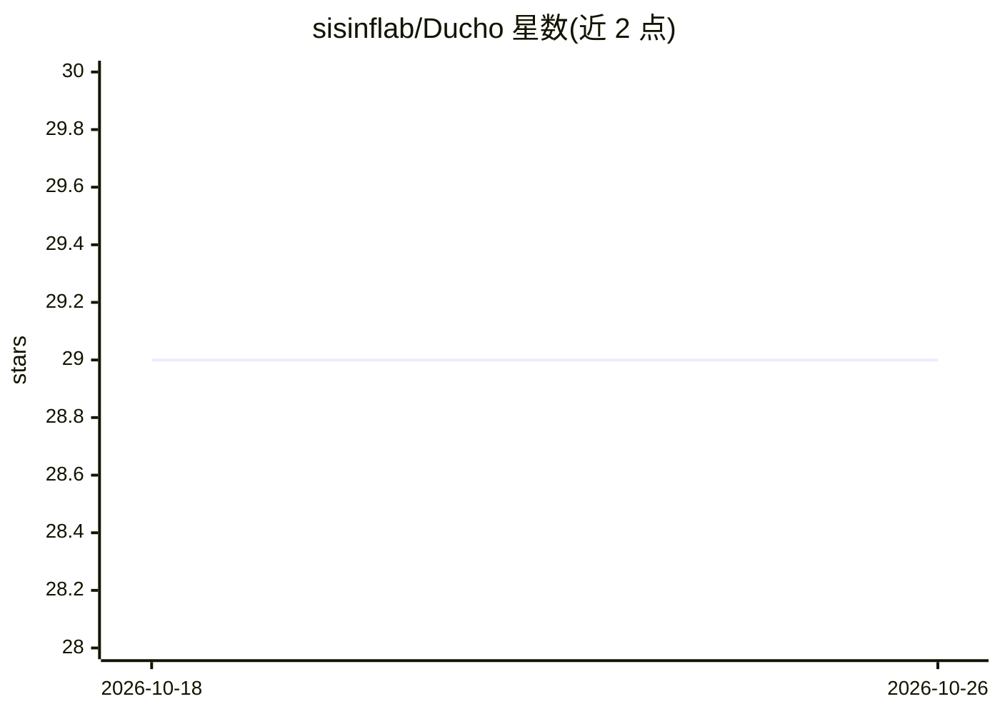

# sisinflab/Ducho

⭐ 29 · Python · 推送 2026-06-24 · [GitHub](https://github.com/sisinflab/Ducho) · [官网](https://dl.acm.org/doi/10.1145/3589335.3651440) · 组织维护

**面向多模态推荐的特征抽取框架：统一接口抽取物品/交互特征**

Ducho v2.0 是一个 Python 框架，用于在多模态推荐场景中抽取物品（如商品图片/描述）与用户-物品交互（如用户评论）的高层特征。它提供统一接口接入 TensorFlow、PyTorch、Transformers、Sentence-Transformers 等深度学习库，通过 YAML 配置文件（可被命令行参数覆盖）指定数据来源、模态（视觉/文本/音频/多模态）、模型列表、输出层与预处理步骤，v2.0 起支持加载用户自训练模型。运行方式包括本地源码、Docker Hub 镜像与 Google Colab。由 Politecnico di Bari sisinflab 团队维护，配套论文发表于 ACM MM 2023 与 TheWebConf 2024。

## 筛选速览

| 维度 | 判定 | 备注 |
|---|---|---|
| AI 角色 | `ai-ecosystem` | LLM/agent 周边工具 |
| 许可风险 | `none` | — |
| 部署形态 | `self-host` | docker 或自建部署 |
| 模型依赖 | — | README 未给出锁定关系 |
| 硬件要求 | — | 无带数字的原话,不猜 |
| 安装摩擦 | `low` | 无编译、无系统依赖或容器化 |
| 成熟度 | — | 结构信号不足 |

## 能力要点

- 统一接口接入 TensorFlow/PyTorch/Transformers/Sentence-Transformers 抽取特征
- YAML 配置驱动的可定制抽取管线，命令行参数可覆盖配置
- v2.0 支持加载用户自训练的预训练模型
- 提供 Docker 镜像与 Google Colab 运行方式及示例 Demo

## 适用场景

- 为推荐系统数据集抽取物品图像与文本特征
- 从用户评论等交互数据抽取文本/情感特征
- 用自训练模型替换默认骨干网络进行特征抽取

## 场景标签

 · 领域:推荐系统/多模态机器学习

## 证据(README 行号)

> L10: Ducho v2.0 is a Python framework for the extraction of multimodal features for recommendation. It provides a unifie
> L128: Currently, Ducho is maintained by:
> L146: @inproceedings{DBLP:conf/www/AttimonelliDMPGD24,

## 星数曲线

2026-10-18 29 → 2026-10-26 29（+0）

---
*卡片 v1 · prompt 1.4 · 生成 2026-10-26 · 置信度 mid · 依据 README sha `c011cc36e70f` · [字段定义](../../DATASET.md)*
