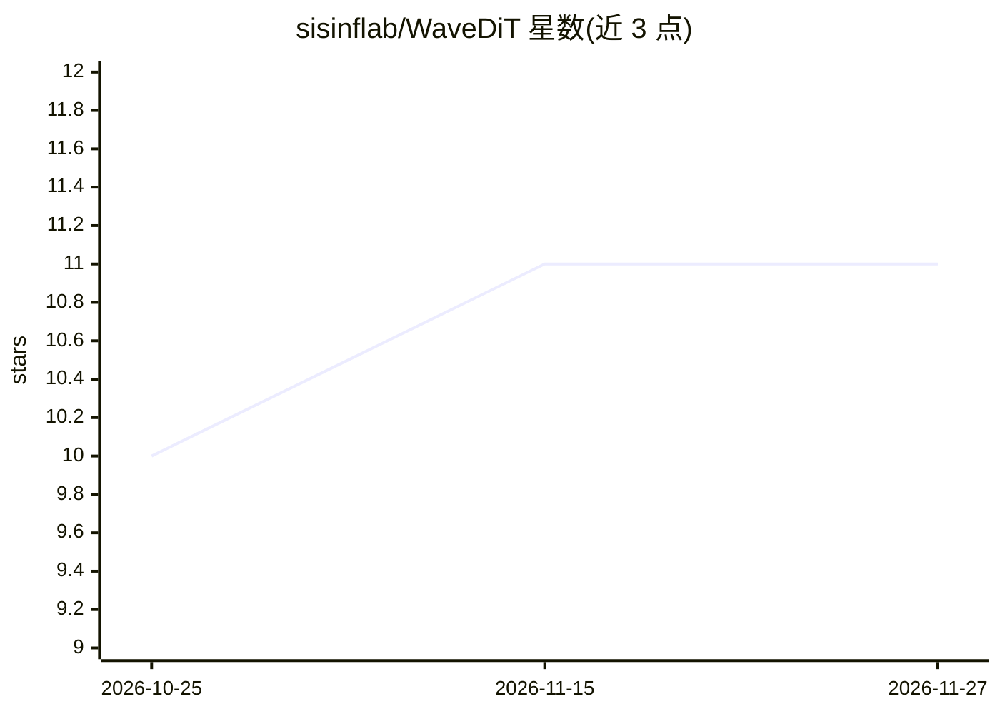

# sisinflab/WaveDiT

⭐ 11 · Python · MIT · 推送 2026-10-09 · [GitHub](https://github.com/sisinflab/WaveDiT) · [官网](https://danesed.github.io/wavedit-page/) · 组织维护

**面向脑 MRI 研究者的小波流匹配 3D 脑部 MRI 合成模型**

MICCAI 2026 论文的官方 PyTorch 实现：在 3D Haar 小波域执行流匹配，配合逐切片 HDiT 骨干与 Morpheus 不确定性调度器（按频段自适应加权损失与采样），支持以年龄等元数据为条件的合成，提供 cfm/rectified/ot_fm 多种流形式。面向医学影像与神经影像研究者，提供 conda+pip 安装、YAML 配置训练、权重继承 warm-start 脚本及 Hugging Face 上的预训练权重（4 GB 显存起可推理）；NATTEN 为可选项，有纯 PyTorch 回退，CPU 也可运行。

## 筛选速览

| 维度 | 判定 | 备注 |
|---|---|---|
| AI 角色 | `ai-native` | 本体是模型或模型工具 |
| 许可风险 | `permissive` | MIT |
| 部署形态 | `library` | 以包/库形式分发 |
| 模型依赖 | — | README 未给出锁定关系 |
| 硬件要求 | — | 无带数字的原话,不猜 |
| 安装摩擦 | `medium` | 含编译或系统依赖之一 |
| 成熟度 | `idea` | |

## 能力要点

- 在 8 通道 3D Haar 小波潜空间做流匹配，支持三种流形式
- Morpheus 调度器按频段统计特征预测 log-variance，加权损失并引导采样
- 权重继承脚本支持 warm-start 变体训练，patch 投影自动重设尺寸
- 4 个发布变体，全分辨率推理显存自 4 GB 起，并提供 HF Spaces 在线 demo

## 适用场景

- 按年龄等条件合成全分辨率 3D 脑部 MRI 样本
- 在自己的脑 MRI 数据集上训练/微调生成模型
- 下载自包含 checkpoint 直接生成，无需重建配置

## 场景标签

`图像生成` `微调` · 领域:内容生成

## 证据(README 行号)

> L11: Official PyTorch implementation of *"WaveDiT: Distribution-Aware Wavelet Flow Matching for Efficient 3D Brain MRI S
> L16: WaveDiT synthesises full resolution, high-fidelity, conditional 3D brain MRIs by performing **flow
> L36: - **Conditional synthesis**: numeric and categorical metadata (e.g. age), with classifier-free guidance.

## 星数曲线

2026-10-25 10 → 2026-11-27 11（+1）

---
*卡片 v1 · prompt 1.4 · 生成 2026-11-18 · 置信度 high · 依据 README sha `1be0e11d3413` · [字段定义](../../DATASET.md)*
