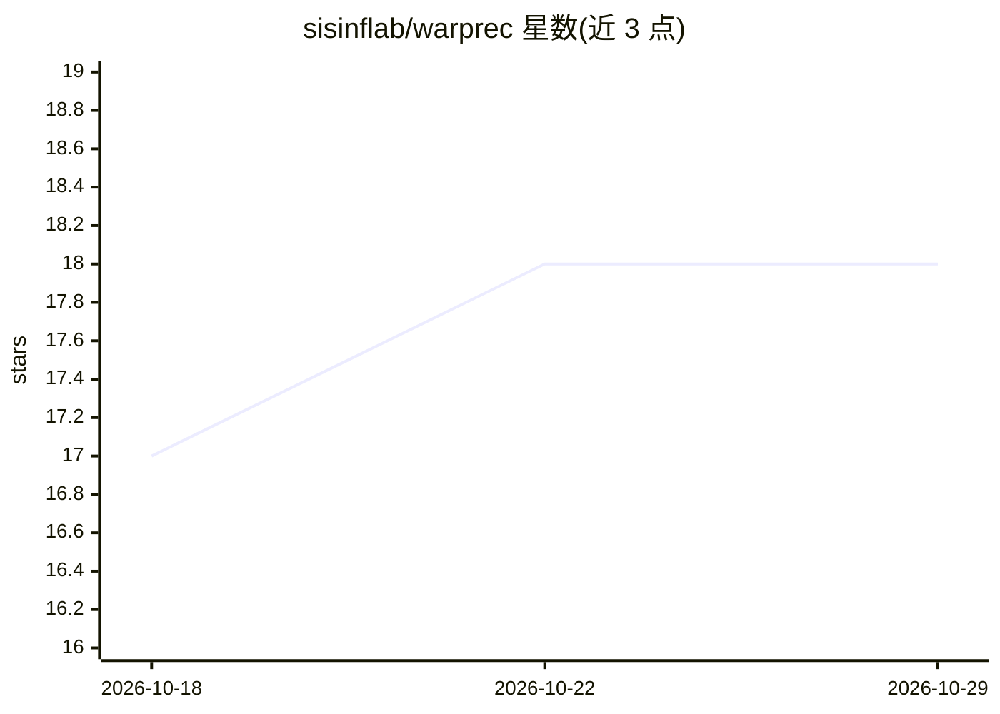

# sisinflab/warprec

⭐ 18 · Python · MIT · 推送 2026-10-23 · [GitHub](https://github.com/sisinflab/warprec) · [官网](https://warprec.readthedocs.io/en/latest/index.html) · 组织维护

**面向研究者的推荐系统训练评估框架（87 个模型）**

基于 PyTorch 的推荐系统框架，内置 87 个模型覆盖协同过滤、上下文感知、序列、知识感知、多模态等 8 类范式；提供数据处理（13 种过滤、8 种切分）、45 种 GPU 加速指标与自动化显著性检验、Ray 分布式训练与超参优化、CodeCarbon 碳排放追踪，以及 Ray Serve REST 服务和 MCP 工具暴露。面向新手与有经验的研究者/开发者，通过 YAML 配置与 CLI 运行训练、设计、评估、服务管线。pip 安装，Python 3.12，多数功能（图模型、服务、MCP 等）需安装对应 extras。

## 筛选速览

| 维度 | 判定 | 备注 |
|---|---|---|
| AI 角色 | `ai-native` | 本体是模型或模型工具 |
| 许可风险 | `permissive` | MIT |
| 部署形态 | `library` | 以包/库形式分发 |
| 模型依赖 | — | README 未给出锁定关系 |
| 硬件要求 | — | 无带数字的原话,不猜 |
| 安装摩擦 | `medium` | 含编译或系统依赖之一 |
| 成熟度 | — | 结构信号不足 |

## 能力要点

- 87 个内置推荐模型，覆盖 8 类范式
- 45 种 GPU 加速评估指标与自动化假设检验（含多重比较校正）
- 单 GPU 到多节点 Ray 集群扩展，实验可暂停/恢复
- 训练模型可经 Ray Serve 提供 REST API 并可暴露为 MCP 工具

## 适用场景

- 在统一管线中训练与对比推荐模型
- 做可复现的推荐系统实验与统计显著性评估
- 将训练好的推荐模型部署为 REST API 或 LLM agent 可调用工具
- 追踪实验的能耗与碳排放

## 场景标签

`推荐系统` · 领域:学习与行业

## 证据(README 行号)

> L18: WarpRec is a flexible and efficient framework designed for building, training, evaluating, and estimating recommend
> L44: - **87 Built-in Algorithms**: WarpRec ships with 87 state-of-the-art recommendation models spanning 8 paradigms — U
> L52: - **Agentic AI via MCP**: Served models can also be exposed as Model Context Protocol tools on the same server (`se

## 星数曲线

2026-10-18 17 → 2026-10-29 18（+1）

---
*卡片 v1 · prompt 1.4 · 生成 2026-10-29 · 置信度 high · 依据 README sha `abd38e3b570b` · [字段定义](../../DATASET.md)*
