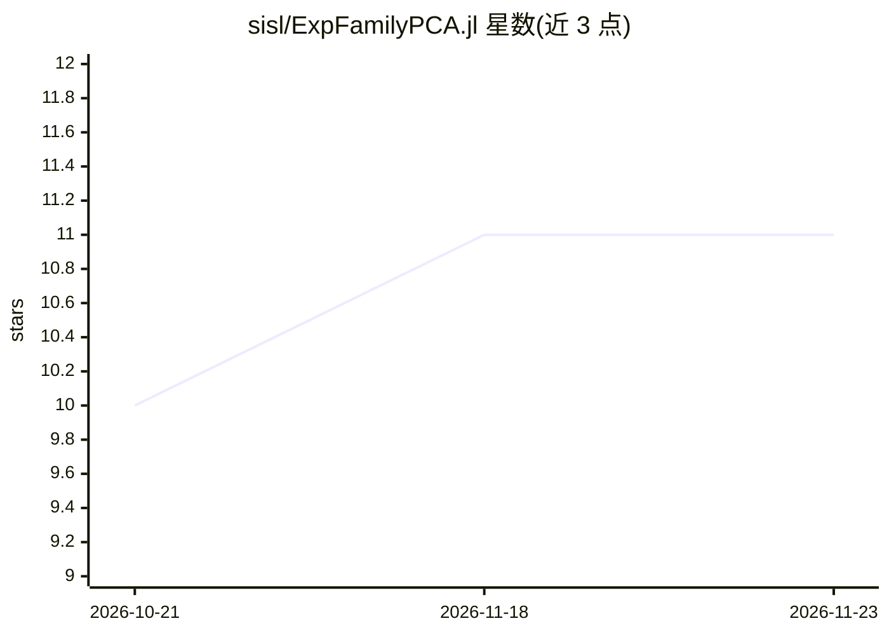

# sisl/ExpFamilyPCA.jl

⭐ 11 · Julia · MIT · 推送 2026-03-09 · [GitHub](https://github.com/sisl/ExpFamilyPCA.jl) · [官网](https://sisl.github.io/ExpFamilyPCA.jl/) · 组织维护

**面向 Julia 用户的指数族 PCA 降维与压缩库**

Julia 包，实现指数族主成分分析（EPCA），将 PCA 推广到非高斯数据（二元、计数、成分数据等），用于降维与数据分析。支持 9 种内置分布（Bernoulli、Poisson、Gamma、Weibull 等），提供 fit!/compress/decompress 三个核心方法，并允许通过自定义 log-partition 函数构造新分布；内置符号微分与数值稳定计算。面向机器学习（信念压缩、文本分析）、信号处理（去噪）与数据科学场景。通过 Julia 包管理器安装，附在线文档与引用论文。

## 筛选速览

| 维度 | 判定 | 备注 |
|---|---|---|
| AI 角色 | `ai-native` | 本体是模型或模型工具 |
| 许可风险 | `permissive` | MIT |
| 部署形态 | `None` |  |
| 模型依赖 | — | README 未给出锁定关系 |
| 硬件要求 | — | 无带数字的原话,不猜 |
| 安装摩擦 | `low` | 无编译、无系统依赖或容器化 |
| 成熟度 | — | 结构信号不足 |

## 能力要点

- 支持 9 种指数族分布的 EPCA 实现（含自定义分布构造器）
- fit!/compress/decompress 三步式压缩-重建接口
- 符号微分优化与数值稳定科学计算
- 提供网站、数学推导与 API 三套文档

## 适用场景

- 对二元/计数/成分等非高斯数据做降维分析
- 信号处理中的去噪
- 强化学习中的信念状态压缩
- 生存分析等场景的分布拟合降维

## 场景标签

 · 领域:机器学习/数据分析

## 证据(README 行号)

> L9: **ExpFamilyPCA.jl** is a Julia package for exponential family principal component analysis (EPCA), a versatile gener
> L16: - Implements exponential family PCA (EPCA)

## 星数曲线

2026-10-21 10 → 2026-11-23 11（+1）

---
*卡片 v1 · prompt 1.4 · 生成 2026-11-18 · 置信度 high · 依据 README sha `456ec358534f` · [字段定义](../../DATASET.md)*
