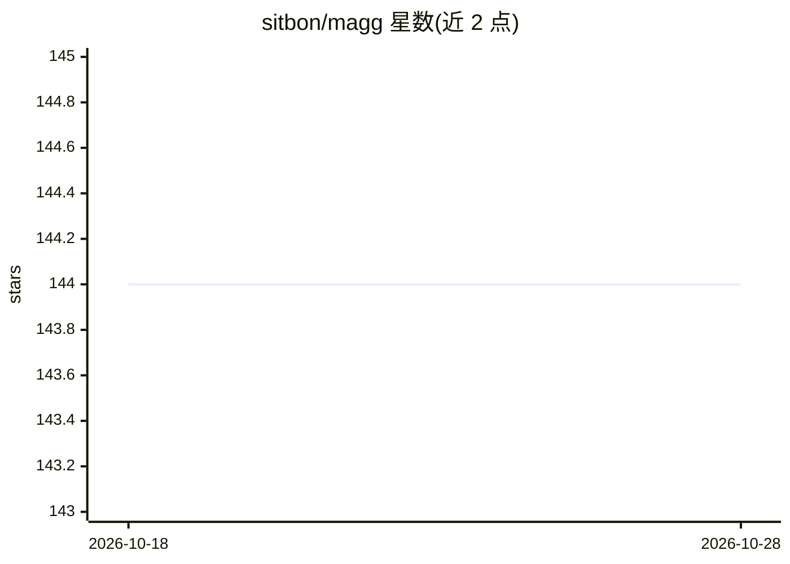

# sitbon/magg

⭐ 144 · Python · AGPL-3.0 · 推送 2026-09-27 · [GitHub](https://github.com/sitbon/magg) · [官网](https://pypi.org/project/magg/) · 个人维护

**管理并代理多个 MCP server 的聚合器，让 LLM 自助扩展工具**

Magg 是一个 meta-MCP server：作为中心枢纽管理、聚合并代理其他 MCP server，提供 magg_add_server、magg_search_servers、magg_check 等 15 个工具，让 LLM 在运行时搜索、添加、启用/禁用后端 server，并以统一前缀聚合各 server 的工具。支持 stdio/HTTP/混合三种运行模式、配置文件监视热重载、可选 RSA-JWT 认证、kit 打组加载，内置 mbro CLI 用于交互式浏览。需要 Python 3.12+，配置持久化于 .magg/config.json。

## 筛选速览

| 维度 | 判定 | 备注 |
|---|---|---|
| AI 角色 | `ai-ecosystem` | LLM/agent 周边工具 |
| 许可风险 | `viral` | AGPL-3.0 |
| 部署形态 | `self-host` | docker 或自建部署 |
| 模型依赖 | — | README 未给出锁定关系 |
| 硬件要求 | — | 无带数字的原话,不猜 |
| 安装摩擦 | `low` | 无编译、无系统依赖或容器化 |
| 成熟度 | — | 结构信号不足 |

## 能力要点

- LLM 运行时自助搜索/添加/启停 MCP server（15 个 magg_* 工具）
- 多 server 工具以统一前缀聚合代理，支持 ProxyMCP 兼容不支持动态更新的客户端
- stdio/HTTP/混合三模式，配置热重载与可选 RSA-JWT 认证
- 内置 mbro（MCP Browser）CLI 支持脚本与交互式管理

## 适用场景

- 通过一个 MCP 入口统一管理多个 MCP server 的工具
- 让 AI 助手在对话中自行安装和配置新的 MCP server
- 用 kit 将相关 MCP server 打组按需加载/卸载

## 场景标签

 · 领域:LLM 基础设施/MCP

## 证据(README 行号)

> L12: A *Model Context Protocol* server that manages, aggregates, and proxies other MCP servers, enabling LLMs to dynamic
> L16: Magg is a meta-MCP server that acts as a central hub for managing multiple MCP servers. It provides tools that allo
> L21: - Aggregate tools from multiple servers under unified prefixes

## 星数曲线

2026-10-18 144 → 2026-10-28 144（+0）

---
*卡片 v1 · prompt 1.4 · 生成 2026-10-22 · 置信度 mid · 依据 README sha `a65909b6f3c8` · [字段定义](../../DATASET.md)*
