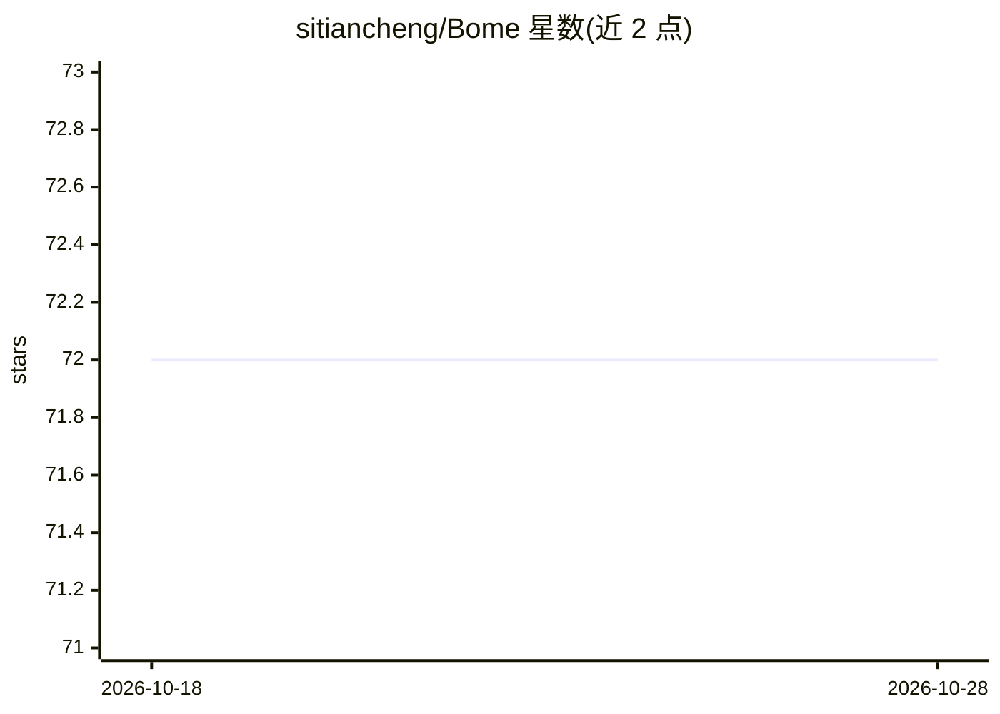

# sitiancheng/Bome

⭐ 72 · HTML · NOASSERTION · 推送 2026-07-09 · [GitHub](https://github.com/sitiancheng/Bome) · 个人维护 · 中文 README

**纯前端 AI 角色语音聊天网页，单 HTML 文件即开即用**

一个用单个 HTML 文件实现的 AI 角色扮演聊天页面：用户填入自定义角色设定，通过浏览器直连五家大模型 API（Claude/DeepSeek/Gemini/GPT/Grok，需自备 API Key）获得双语回复，配合 ElevenLabs 做语音朗读、OpenAI 做语音转文字。功能包括跨对话长期记忆、每日自动日记、小游戏、主动消息、表情包、联网搜索与屏幕观览等。无后端服务器，Key 仅存浏览器本地；采用 CC BY-NC-SA 4.0 许可证，禁止商用。手机端存在浏览器限制（需 https、不支持文件夹记忆库）。

## 筛选速览

| 维度 | 判定 | 备注 |
|---|---|---|
| AI 角色 | `ai-native` | 本体是模型或模型工具 |
| 许可风险 | `none` | NOASSERTION |
| 部署形态 | `None` |  |
| 模型依赖 | locked-api |  |
| 硬件要求 | — | 无带数字的原话,不猜 |
| 安装摩擦 | `low` | 无编译、无系统依赖或容器化 |
| 成熟度 | — | 结构信号不足 |

## 能力要点

- 五个模型版本（Claude/DeepSeek/Gemini/GPT/Grok）共用同一套存档格式，可随时切换
- 长期记忆、每日日记、主动消息与小游戏等角色互动功能
- 纯前端运行：双击 HTML 即用，无服务器，Key 仅存本地浏览器
- 网页端与手机端两种形态，存档可导出导入跨设备搬运

## 适用场景

- 创建一个有记忆、会说话、会写日记的专属 AI 聊天角色
- 在电脑或手机浏览器里进行语音角色扮演聊天
- 在不同大模型之间切换大脑且保留聊天记录与记忆

## 场景标签

`聊天机器人` `语音 Agent` · 领域:对话与助手

## 证据(README 行号)

> L3: 一个纯前端的 **AI 角色语音聊天网页**。单个 HTML 文件，双击就能用，不需要服务器、不需要安装任何东西。
> L25: 同样的功能，五种不同的 AI 大脑，选你有 API Key 的那个：

## 星数曲线

2026-10-18 72 → 2026-10-28 72（+0）

---
*卡片 v1 · prompt 1.4 · 生成 2026-10-24 · 置信度 high · 依据 README sha `8276515a0e32` · [字段定义](../../DATASET.md)*
