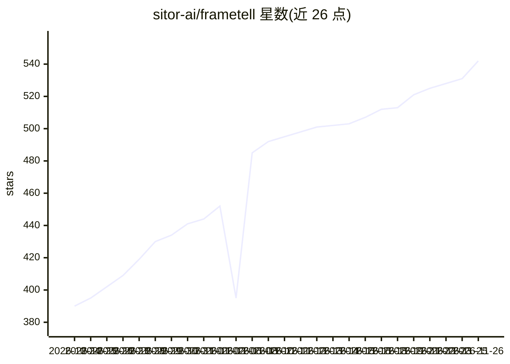

# sitor-ai/frametell

⭐ 542 · TypeScript · AGPL-3.0 · 推送 2026-11-24 · [GitHub](https://github.com/sitor-ai/frametell) · [官网](https://frametell.ai) · 组织维护 · 中文 README

**面向知识创作者：用 AI 导演把想法/素材生成为讲解视频**

Electron 桌面应用，用户输入一句话或上传文档/PDF/幻灯片/图片，导演 agent 先生成故事板供确认，随后撰写解说词、配音、逐页绘制画面并自检，最终渲染 1080p MP4 含字幕。本地优先，素材与 API key 留在本机；支持多家模型服务商及 OpenAI/Anthropic 兼容端点。成品可在内置编辑器中手动修改，手改以图层叠加且不消耗 token，版本记录基于 git 历史。macOS Apple Silicon 提供安装包，Windows/Intel Mac 需从源码运行；页面绘制依赖本机 Chrome/Edge/Chromium。

## 筛选速览

| 维度 | 判定 | 备注 |
|---|---|---|
| AI 角色 | `ai-native` | 本体是模型或模型工具 |
| 许可风险 | `viral` | AGPL-3.0 |
| 部署形态 | `desktop` | 安装包/桌面程序 |
| 模型依赖 | — | README 未给出锁定关系 |
| 硬件要求 | — | 无带数字的原话,不猜 |
| 安装摩擦 | `medium` | 含编译或系统依赖之一 |
| 成熟度 | — | 结构信号不足 |

## 能力要点

- 导演 agent 生成故事板经用户确认后再生成
- 配音支持 ElevenLabs 与火山引擎 TTS（中文）
- 内置 warm-story/study/chalkboard 等多种样式，成品可在时间线编辑器手动修改
- 本地优先，支持任意 OpenAI/Anthropic 兼容端点

## 适用场景

- 把一段笔记或 PDF 讲解稿转成带配音的讲解视频
- 科普/历史/投资类知识创作者不学剪辑也能出片
- 让 agent 生成故事板并人工审核后再产出视频
- 生成中文讲解视频并后期手动修正细节

## 场景标签

`语音合成` `视频生成` · 领域:内容生成

## 证据(README 行号)

> L7: **Frametell** (帧言, *zhēn yán*) turns your ideas and your material into vivid explainer videos with pages that move. 
> L32: - **Runs locally, with any model.** Your materials and API keys stay on your computer. It works with Anthropic, Ope
> L40: 5. **Film.** It runs a final check on the full video, then renders a 1080p MP4 with subtitles.

## 星数曲线

2026-10-24 390 → 2026-11-26 542（+152）

---
*卡片 v1 · prompt 1.4 · 生成 2026-11-25 · 置信度 mid · 依据 README sha `19485c3edaaa` · [字段定义](../../DATASET.md)*
