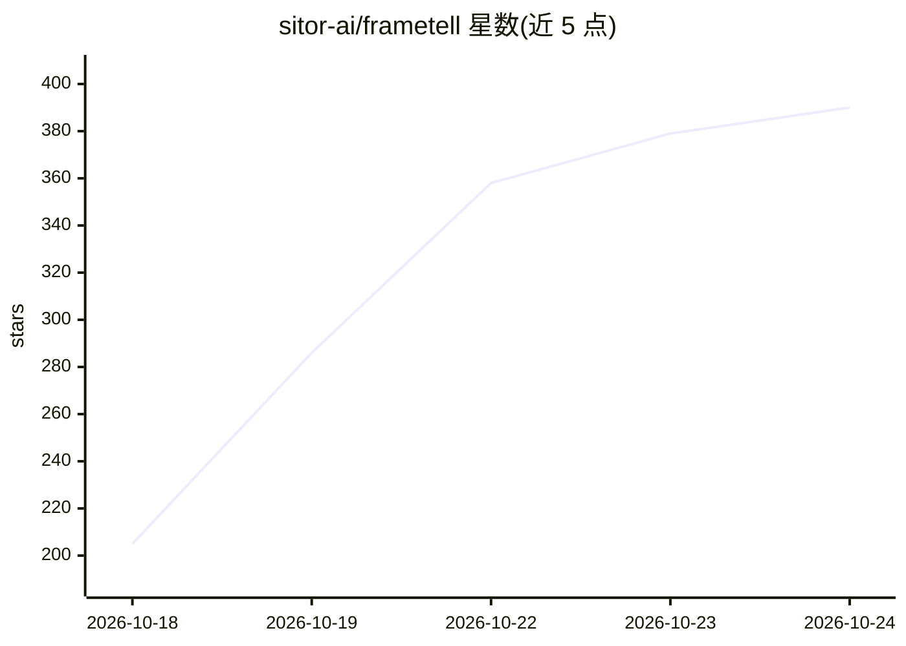

# sitor-ai/frametell

⭐ 390 · TypeScript · AGPL-3.0 · 推送 2026-10-22 · [GitHub](https://github.com/sitor-ai/frametell) · [官网](https://frametell.ai) · 组织维护 · 中文 README

**面向知识创作者的 AI 解说视频生成桌面应用**

基于 Electron 的桌面应用：用户输入一句话或导入文档、PDF、幻灯片、图片，AI 导演 agent 先产出分镜脚本供用户确认，随后撰写旁白、用 ElevenLabs（中文用火山引擎 TTS）配音、逐页绘制画面并做质量检查，最终渲染带字幕的 1080p MP4。本地优先，材料与 API key 留在本机，支持 Anthropic、OpenAI、Google、DeepSeek、OpenRouter 等或任意 OpenAI/Anthropic 兼容端点。目前提供 macOS Apple Silicon 安装包，Windows/Intel Mac 需从源码运行，渲染依赖 Chrome/Edge/Chromium。

## 筛选速览

| 维度 | 判定 | 备注 |
|---|---|---|
| AI 角色 | `ai-native` | 本体是模型或模型工具 |
| 许可风险 | `viral` | AGPL-3.0 |
| 部署形态 | `desktop` | 安装包/桌面程序 |
| 模型依赖 | — | README 未给出锁定关系 |
| 硬件要求 | — | 无带数字的原话,不猜 |
| 安装摩擦 | `medium` | 含编译或系统依赖之一 |
| 成熟度 | — | 结构信号不足 |

## 能力要点

- 导演 agent 先出分镜供用户签核，再执行旁白、配音、绘制与渲染
- 支持多种模型提供商及任意 OpenAI/Anthropic 兼容端点，材料与密钥留在本地
- 内置 5 种视频风格，逐页 lint 与截图质检，输出带字幕的 1080p MP4
- 提供 macOS Apple Silicon 签名公证安装包，也可 Node.js + pnpm 从源码运行

## 适用场景

- 把一段想法或现有笔记、PDF 讲义快速做成解说视频
- 科普、读书、投资等知识内容创作者不学剪辑即产出成片
- 先审分镜再生成，控制视频内容与成本

## 场景标签

`视频生成` · 领域:内容生成

## 证据(README 行号)

> L7: **Frametell** (帧言, *zhēn yán*) turns your ideas and your material into vivid explainer videos with pages that move. 
> L32: - **Runs locally, with any model.** Your materials and API keys stay on your computer. It works with Anthropic, Ope

## 星数曲线

2026-10-18 205 → 2026-10-24 390（+185）

---
*卡片 v1 · prompt 1.4 · 生成 2026-10-21 · 置信度 mid · 依据 README sha `22cd2735dc51` · [字段定义](../../DATASET.md)*
