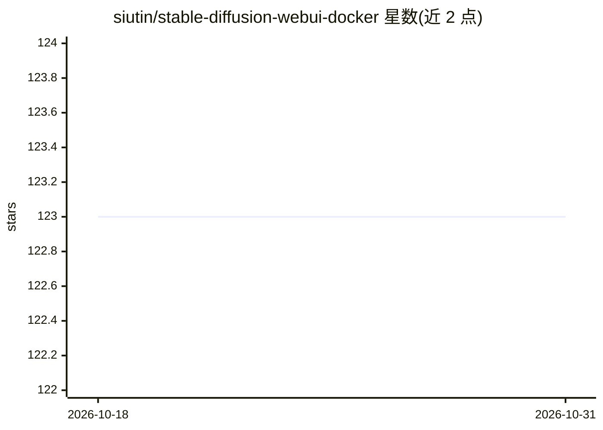

# siutin/stable-diffusion-webui-docker

⭐ 123 · 推送 2026-10-18 · [GitHub](https://github.com/siutin/stable-diffusion-webui-docker) · [官网](https://hub.docker.com/r/siutin/stable-diffusion-webui-docker) · 个人维护

**将 AUTOMATIC1111 stable-diffusion-webui 打包为 Docker 镜像的运行方案**

提供 stable-diffusion-webui 的预构建 Docker 镜像，支持 CUDA 与纯 CPU 两种运行方式，通过 docker run 挂载 models/outputs 目录启动 WebUI；README 给出主机目录权限准备、镜像版本回退建议（遇兼容问题可切换到指定 CUDA 版本镜像）以及用 Dockerfile.cuda/Dockerfile 自定义构建的说明，另附查看本机 CUDA Driver API 版本的命令。面向希望在容器环境中运行 Stable Diffusion WebUI 的用户。

## 筛选速览

| 维度 | 判定 | 备注 |
|---|---|---|
| AI 角色 | `ai-ecosystem` | LLM/agent 周边工具 |
| 许可风险 | `none` | — |
| 部署形态 | `self-host` | docker 或自建部署 |
| 模型依赖 | — | README 未给出锁定关系 |
| 硬件要求 | — | 无带数字的原话,不猜 |
| 安装摩擦 | `low` | 无编译、无系统依赖或容器化 |
| 成熟度 | — | 结构信号不足 |

## 能力要点

- 提供 CUDA 与纯 CPU 两种预构建镜像
- docker run 挂载 models/outputs 目录即可启动 WebUI
- 支持基于 Dockerfile 自定义构建镜像（linux/amd64）

## 适用场景

- 在 Docker 容器中运行 Stable Diffusion WebUI，避免本机环境配置
- 无 NVIDIA 显卡时用 latest-cpu 镜像以 CPU 跑 WebUI
- 按需构建自定义版本的 WebUI 镜像

## 场景标签

`图像生成` · 领域:内容生成

## 证据(README 行号)

> L1: # Stable Diffusion Webui Docker Image
> L20: ### Run with CUDA
> L29: ### Run with CPU only

## 星数曲线

2026-10-18 123 → 2026-10-31 123（+0）

---
*卡片 v1 · prompt 1.4 · 生成 2026-10-23 · 置信度 high · 依据 README sha `d6ab6b46eb4a` · [字段定义](../../DATASET.md)*
