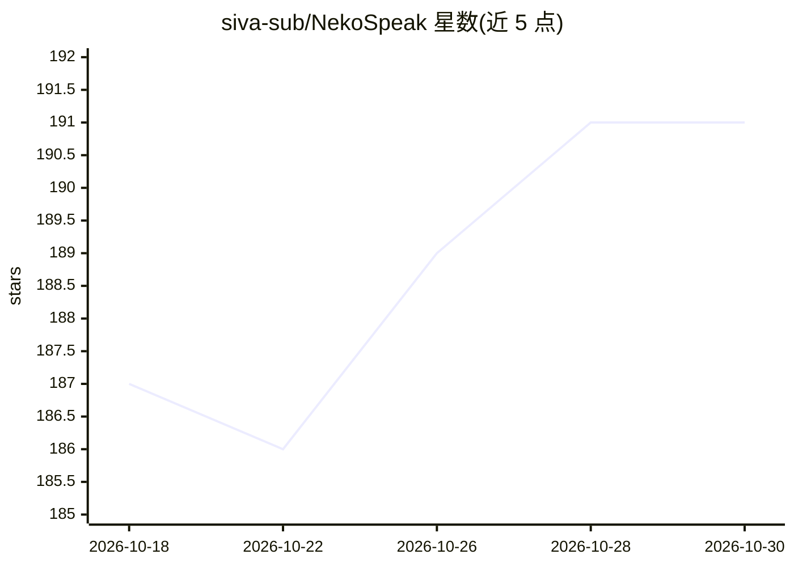

# siva-sub/NekoSpeak

⭐ 191 · Kotlin · MIT · 推送 2026-05-19 · [GitHub](https://github.com/siva-sub/NekoSpeak) · 个人维护

**安卓离线 AI 文字转语音应用，多 TTS 引擎本地运行**

面向 Android 用户的设备端 TTS 引擎，通过 ONNX Runtime 在 CPU 上运行 Piper、Kokoro、Kitten TTS 与 Pocket-TTS 四种模型，100% 离线、无云端数据传输。功能包括零样本语音克隆、名人语音包下载、百余个 Piper 社区语音、以及接入系统级 Android TTS API 供任意应用调用。自适应流式引擎按设备实测生成速度调节缓冲。限制：仅 CPU 推理（NNAPI/QNN 因算子不支持未采用），慢设备上长句仍可能卡顿；发布形式为 GitHub Release APK，源码需 Android Studio 编译。

## 筛选速览

| 维度 | 判定 | 备注 |
|---|---|---|
| AI 角色 | `ai-native` | 本体是模型或模型工具 |
| 许可风险 | `permissive` | MIT |
| 部署形态 | `None` |  |
| 模型依赖 | — | README 未给出锁定关系 |
| 硬件要求 | `cpu-ok` | |
| 安装摩擦 | `low` | 无编译、无系统依赖或容器化 |
| 成熟度 | — | 结构信号不足 |

## 能力要点

- 四种 TTS 引擎（Pocket-TTS/Piper/Kokoro/KittenTTS），全部设备端离线运行
- 语音克隆（录音或上传音频创建自定义音色）与名人语音包
- 接入系统 Android TTS API，可被任意支持 TTS 的应用调用
- 自调优并行流式引擎，按设备性能动态调整缓冲

## 适用场景

- 在 MoonReader 等阅读应用中离线听书且不发数据到云端
- 为需要语音辅助的用户提供自定义语音的离线 TTS
- 在低端手机上用小体积模型实现本地语音合成

## 场景标签

`语音合成` · 领域:内容生成

## 证据(README 行号)

> L12: **NekoSpeak** is a high-performance, on-device Text-to-Speech (TTS) engine for Android, capable of running **100% o
> L33: * **Privacy First**: All processing happens 100% on-device. No data is ever sent to the cloud.

## 星数曲线

2026-10-18 187 → 2026-10-30 191（+4）

---
*卡片 v1 · prompt 1.4 · 生成 2026-10-22 · 置信度 high · 依据 README sha `3c951083eb72` · [字段定义](../../DATASET.md)*
