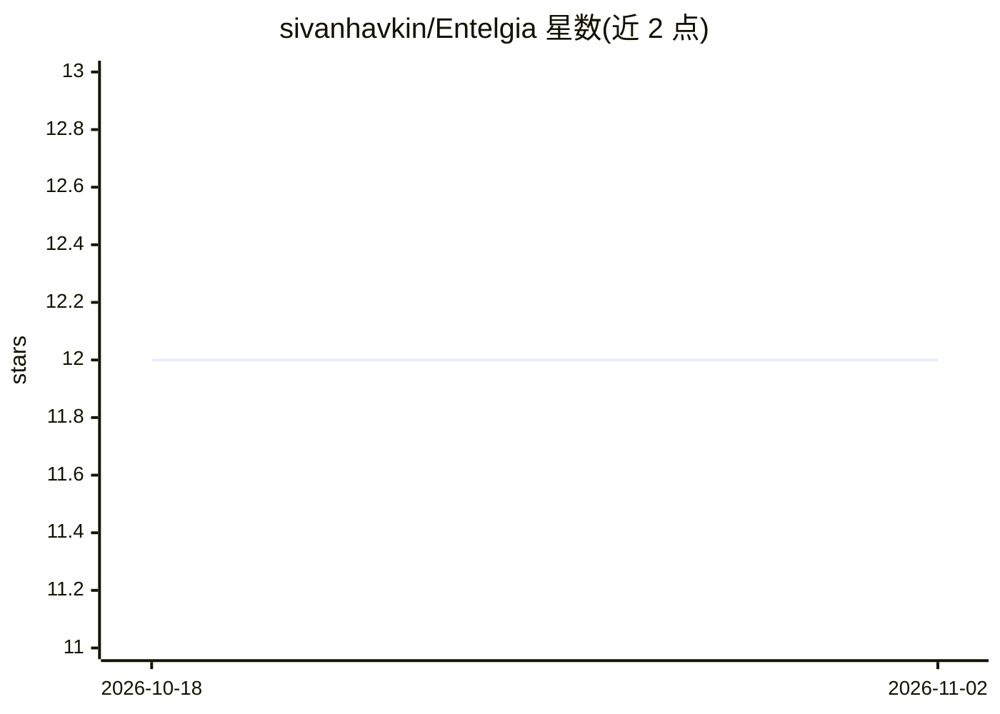

# sivanhavkin/Entelgia

⭐ 12 · Python · MIT · 推送 2026-07-30 · [GitHub](https://github.com/sivanhavkin/Entelgia) · 个人维护

**实验性对话治理多智能体认知架构：让 agent 随时间演化内在身份**

Entelgia 是一个实验性多智能体 AI 架构，研究持久身份、内部冲突动力学与行为调节如何通过长期记忆与结构化对话涌现。它由 LLM、持久记忆（短期 JSON + 长期 SQLite）、心理驱力与观察者调节回路组成，与无状态聊天系统不同，内部状态随时间演化。支持四种 LLM 后端：本地 Ollama（需 7B 以上模型与 8GB+ 内存）或 Grok/OpenAI/Anthropic 云 API。提供自动安装脚本与 GitHub pip 安装，附带记忆清除工具；自定位为『Research Hybrid』，部分组件演化较快，要求 7B 以上模型才能可靠支撑多层反思推理。

## 筛选速览

| 维度 | 判定 | 备注 |
|---|---|---|
| AI 角色 | `ai-native` | 本体是模型或模型工具 |
| 许可风险 | `permissive` | MIT |
| 部署形态 | `library` | 以包/库形式分发 |
| 模型依赖 | local-ok | 支持本地模型 |
| 硬件要求 | — | 无带数字的原话,不猜 |
| 安装摩擦 | `low` | 无编译、无系统依赖或容器化 |
| 成熟度 | `idea` | |

## 能力要点

- LLM + 持久记忆 + 心理驱力 + 观察者调节的对话治理 agent 架构
- 短期记忆（JSON）与长期记忆（SQLite）分离，含记忆清除工具
- 四种可选后端：Ollama 本地 / Grok / OpenAI / Anthropic 云 API，启动时切换
- 提供自动化安装脚本（scripts/install.py）

## 适用场景

- 研究 agent 身份、内部冲突与行为调节的涌现机制
- 构建有持久记忆与反思能力的多智能体系统
- 对比本地 Ollama 与云端 API 后端运行认知架构实验

## 场景标签

`多智能体` `Agent 记忆` · 领域:Agent 开发

## 证据(README 行号)

> L19: **Entelgia** is an experimental multi-agent AI architecture.
> L31: LLM + Persistent Memory + Psychological Drives + Observer Regulation --> Dialogue-governed agents
> L39: Instead of external guardrails, agents develop regulation through:

## 星数曲线

2026-10-18 12 → 2026-11-02 12（+0）

---
*卡片 v1 · prompt 1.4 · 生成 2026-11-01 · 置信度 high · 依据 README sha `de5a001ba4fe` · [字段定义](../../DATASET.md)*
