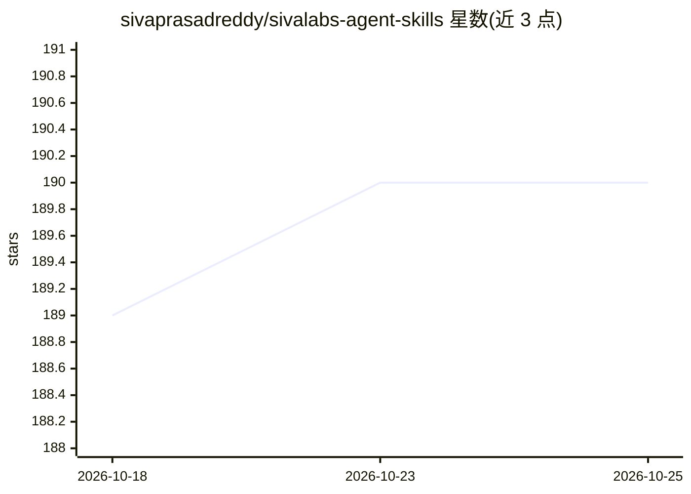

# sivaprasadreddy/sivalabs-agent-skills

⭐ 190 · Python · MIT · 推送 2026-10-12 · [GitHub](https://github.com/sivaprasadreddy/sivalabs-agent-skills) · 个人维护

**面向 AI 编码代理的 Spring Boot 技能/规范集合**

由 SivaLabs 维护的 agent 技能（skills/guidelines）集合，包含 Spring Boot、Spring Modulith Verifier、jSpecify、Java Code Review、Renovate PR 处理等 6 项技能，用于指导 AI 编码代理构建应用。通过 npx skills add 或 install.sh 脚本安装，支持复制到 Claude Code、Codex、Gemini、Cursor 等代理的项目级或用户级 skills 目录。

## 筛选速览

| 维度 | 判定 | 备注 |
|---|---|---|
| AI 角色 | `ai-knowledge` | 知识聚合/清单类 |
| 许可风险 | `permissive` | MIT |
| 部署形态 | `library` | 以包/库形式分发 |
| 模型依赖 | — | README 未给出锁定关系 |
| 硬件要求 | — | 无带数字的原话,不猜 |
| 安装摩擦 | `low` | 无编译、无系统依赖或容器化 |
| 成熟度 | — | 结构信号不足 |

## 能力要点

- 6 项技能：Progen、Spring Boot、Spring Modulith Verifier、jSpecify、Java Code Review、Renovate PR
- npx skills add 支持整库或指定技能安装
- install.sh 一键为所有支持的代理安装到项目级
- 兼容 Claude Code / Codex / Gemini / Cursor 的 skills 目录约定

## 适用场景

- 让 AI 编码代理遵循 Spring Boot 编码规范
- 为代理添加 Java 代码审查与 jSpecify 空值注解检查能力
- 自动应用 Renovate 依赖更新 PR

## 场景标签

`提示工程` · 领域:Agent 开发

## 证据(README 行号)

> L3: A collection of skills/guidelines for building applications using AI Agents.
> L6: - Progen

## 星数曲线

2026-10-18 189 → 2026-10-25 190（+1）

---
*卡片 v1 · prompt 1.4 · 生成 2026-10-22 · 置信度 high · 依据 README sha `54d05459f8d8` · [字段定义](../../DATASET.md)*
