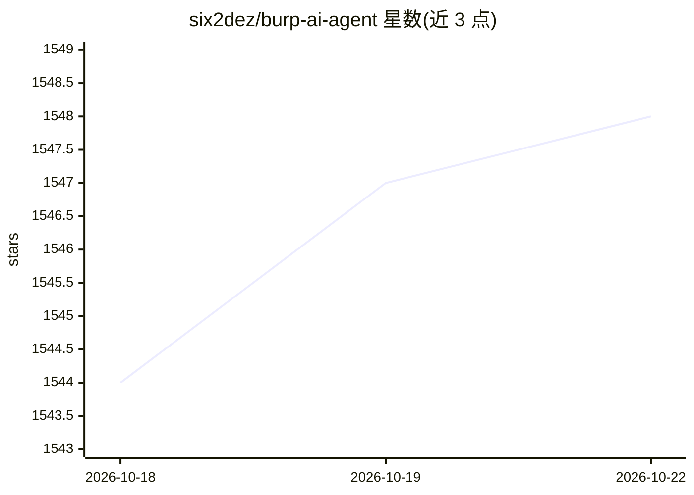

# six2dez/burp-ai-agent

⭐ 1,554 · Kotlin · MIT · 推送 2026-10-21 · [GitHub](https://github.com/six2dez/burp-ai-agent) · [官网](https://burp-ai-agent.six2dez.com/) · 个人维护

**Burp Suite 的 AI 集成扩展：多后端模型分析与 MCP 扫描**

Burp Suite 的 Java 扩展（原名 Burp AI Agent），把 AI 接入渗透测试流程：支持 Burp AI 内置后端、Ollama/LM Studio 本地模型、Anthropic/Perplexity/NVIDIA NIM 等云 API 及多个 CLI 后端；提供 59 个 MCP 工具让 Claude Desktop 等 MCP 客户端驱动 Burp，覆盖 62 类漏洞的被动/主动 AI 扫描。含 3 档隐私模式（敏感数据出站前脱敏）、工具调用人工确认、SHA-256 审计日志。以 JAR 包从 Releases 安装加载，或用 Java 21 从源码构建。

## 筛选速览

| 维度 | 判定 | 备注 |
|---|---|---|
| AI 角色 | `ai-native` | 本体是模型或模型工具 |
| 许可风险 | `permissive` | MIT |
| 部署形态 | `None` |  |
| 模型依赖 | local-ok | 支持本地模型 |
| 硬件要求 | — | 无带数字的原话,不猜 |
| 安装摩擦 | `medium` | 含编译或系统依赖之一 |
| 成熟度 | — | 结构信号不足 |

## 能力要点

- 12 种 AI 后端（本地 HTTP、云 API、CLI 三类）
- 59 个 MCP 工具供 Claude Desktop 等客户端驱动 Burp，可限定仅访问范围内目标
- 62 类漏洞的被动/主动 AI 扫描（扫描器默认关闭，主动操作需确认）
- STRICT/BALANCED/OFF 三档隐私模式与 opt-in JSONL 审计日志

## 适用场景

- 在 Burp 中右键让 AI 分析抓到的 HTTP 请求
- 用 Claude Desktop 等 MCP 客户端自动驱动 Burp 做安全测试
- 接入本地 Ollama 模型分析流量而不外发数据
- 对目标站做 AI 辅助的被动漏洞扫描

## 场景标签

`网络安全` · 领域:学习与行业

## 证据(README 行号)

> L9: Custom AI Agent is an extension for Burp Suite that integrates AI into your security workflow. Use local models or c
> L93: - **12 AI Backends** — Burp AI (built-in), Anthropic, Ollama, LM Studio, NVIDIA NIM, Perplexity, Generic OpenAI-com
> L94: - **59 MCP Tools** — Let Claude Desktop (or any MCP client) drive Burp autonomously (8 extension-native AI tools in

## 星数曲线

2026-10-18 1,544 → 2026-10-22 1,548（+4）

---
*卡片 v1 · prompt 1.4 · 生成 2026-10-21 · 置信度 high · 依据 README sha `9ab48131320d` · [字段定义](../../DATASET.md)*
