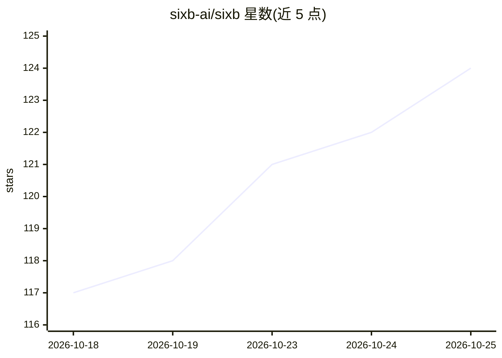

# sixb-ai/sixb

⭐ 124 · TypeScript · MIT · 推送 2026-10-24 · [GitHub](https://github.com/sixb-ai/sixb) · [官网](https://docs.sixb.ai) · 组织维护

**TypeScript 本体驱动框架：统一数据模型供应用与 AI agent 使用**

面向开发者的 TypeScript 框架：用 defineObjectType 等在代码中定义领域本体（类型、关系、动作），外部系统数据经映射汇入共享模型，框架据此提供 API、带类型的查询与运行时权限控制，应用与工作流共用同一模型并将动作回写源系统。内置 AI agent 通过 Sixb CLI 在沙箱中操作该模型，聊天中继承用户权限，工作流中可指定其访问范围。附 Northline Mechanical 参考应用。当前 0.1.x 版本可能包含破坏性变更与数据库迁移。

## 筛选速览

| 维度 | 判定 | 备注 |
|---|---|---|
| AI 角色 | `ai-ecosystem` | LLM/agent 周边工具 |
| 许可风险 | `permissive` | MIT |
| 部署形态 | `None` |  |
| 模型依赖 | — | README 未给出锁定关系 |
| 硬件要求 | — | 无带数字的原话,不猜 |
| 安装摩擦 | `low` | 无编译、无系统依赖或容器化 |
| 成熟度 | `idea` | |

## 能力要点

- TypeScript 定义本体，同一模型供应用、工作流与 AI agent 共用
- 运行时权限控制：聊天中 agent 继承用户权限，工作流中可指定访问
- 连接外部系统、映射数据到共享模型，动作回写源系统
- 每个应用内置本体图浏览、数据探查与工作流运行查看页面

## 适用场景

- 把分散系统数据统一成共享领域模型构建业务应用
- 让 AI agent 在受控权限与沙箱内操作业务数据
- 构建带人工审核步骤的事件驱动工作流

## 场景标签

`Agent 框架` `工作流自动化` · 领域:Agent 开发

## 证据(README 行号)

> L5: A TypeScript framework for ontology-powered apps and AI.
> L57: The built-in AI agent works with that same model through the Sixb CLI

## 星数曲线

2026-10-18 117 → 2026-10-25 124（+7）

---
*卡片 v1 · prompt 1.4 · 生成 2026-10-23 · 置信度 high · 依据 README sha `91f6518a0ed0` · [字段定义](../../DATASET.md)*
