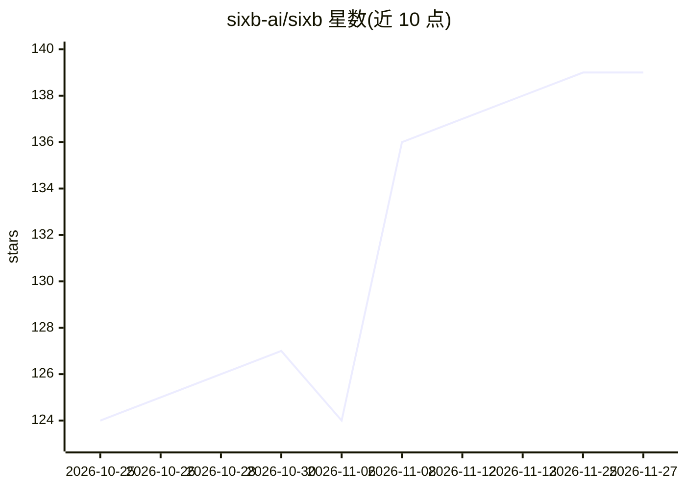

# sixb-ai/sixb

⭐ 139 · TypeScript · MIT · 推送 2026-11-26 · [GitHub](https://github.com/sixb-ai/sixb) · [官网](https://docs.sixb.ai) · 组织维护

**面向开发者与 AI agent 的 TypeScript 本体驱动应用框架**

Sixb 是一个 TypeScript 框架，用于构建由本体（ontology）驱动的应用与 AI。开发者连接 Pipedrive、QuickBooks、Excel 等业务系统，用 TypeScript 定义领域对象类型及其关系，通过 sync 与 projection 将源系统数据映射到模型上；在此模型之上构建应用、agent 与工作流。内置 agent 基于同一模型读取类型、查询数据并经 Sixb CLI 在沙箱中请求操作，运行于用户配置的语言模型上。需 Bun 1.4.4+，本地运行无需数据库与 API key；处于 0.1.x 活跃开发期，版本可能包含破坏性变更。

## 筛选速览

| 维度 | 判定 | 备注 |
|---|---|---|
| AI 角色 | `ai-ecosystem` | LLM/agent 周边工具 |
| 许可风险 | `permissive` | MIT |
| 部署形态 | `None` |  |
| 模型依赖 | — | README 未给出锁定关系 |
| 硬件要求 | — | 无带数字的原话,不猜 |
| 安装摩擦 | `low` | 无编译、无系统依赖或容器化 |
| 成熟度 | `idea` | |

## 能力要点

- TypeScript 定义本体类型，sync/projection 将业务系统数据映射到模型
- 内置 Agent、Console、Settings 页面，开箱即用
- action 带类型与权限检查，可写回源系统
- agent 经 CLI 在沙箱中执行，权限可按对话或工作流配置

## 适用场景

- 连接 CRM/财务/办公系统，用统一模型构建业务应用
- 让 agent 基于业务本体查询数据并代为执行操作
- 将多系统数据整合为版本化数据集再做建模

## 场景标签

`工作流自动化` `Agent 框架` · 领域:Agent 开发

## 证据(README 行号)

> L5: A TypeScript framework for ontology-powered apps and AI.
> L86: The built-in agent works from the same model. It reads your types,
> L89: workflow, you decide its access. It runs on the language models

## 星数曲线

2026-10-25 124 → 2026-11-27 139（+15）

---
*卡片 v1 · prompt 1.4 · 生成 2026-11-27 · 置信度 high · 依据 README sha `0eb3864ddd5c` · [字段定义](../../DATASET.md)*
