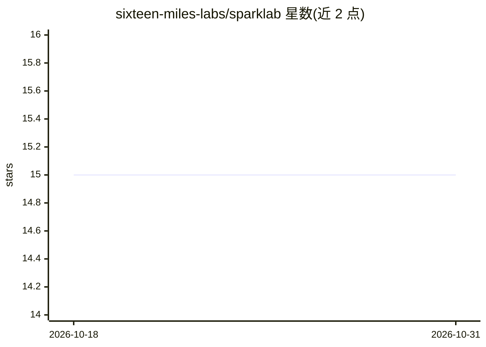

# sixteen-miles-labs/sparklab

⭐ 15 · Python · Apache-2.0 · 推送 2026-10-26 · [GitHub](https://github.com/sixteen-miles-labs/sparklab) · 组织维护

**在 NVIDIA DGX Spark 上本地私有运行前沿开源权重模型的推理产品**

面向 NVIDIA DGX Spark（GB10 Grace Blackwell）单机部署的 GB10 原生推理产品，由 SixteenMiles Labs（Oakmind AI 旗下研究实验室）开发。提供不可变模型配方、统一内存准入规划、可断点续传的 checkpoint 获取、FTW 准备与 NVMe 支撑的 MoE 执行，使部分大参数 MoE 检查点可超出物理内存运行；对外暴露 OpenAI Chat Completions/Responses 与 Anthropic Messages 兼容的本地回环 API。模型组合覆盖 Qwen、DeepSeek、GLM、Kimi 等多档，多数条目处于 Experimental/Preview 状态，仅支持单一硬件配置，多节点与高并发不在 Beta 范围内。

## 筛选速览

| 维度 | 判定 | 备注 |
|---|---|---|
| AI 角色 | `ai-ecosystem` | LLM/agent 周边工具 |
| 许可风险 | `permissive` | Apache-2.0 |
| 部署形态 | `None` |  |
| 模型依赖 | — | README 未给出锁定关系 |
| 硬件要求 | — | 无带数字的原话,不猜 |
| 安装摩擦 | `medium` | 含编译或系统依赖之一 |
| 成熟度 | `idea` | |

## 能力要点

- OpenAI 与 Anthropic 兼容的本地 API（含流式、推理、工具调用）
- FTW 专家库与 NVMe 支撑缓存使 MoE 检查点可超出物理内存运行
- sparklab doctor 校验架构、CUDA、统一内存、swap 与 NVMe 容量
- 不可变配方固定模型版本并记录 manifest 与产物指纹

## 适用场景

- 在 DGX Spark 上离线运行 DeepSeek/GLM/Kimi 等大参数开源模型
- 以 OpenAI/Anthropic 兼容 API 做本地推理开发与 agent 循环
- 在 128GB 统一内存内做预算化的多模型部署

## 场景标签

`推理引擎` · 领域:训练与推理

## 证据(README 行号)

> L29: SparkLab is a GB10-native inference product for local, single-system deployments. It
> L62: - **Stable local APIs:** OpenAI Chat Completions, Responses, and Anthropic Messages share

## 星数曲线

2026-10-18 15 → 2026-10-31 15（+0）

---
*卡片 v1 · prompt 1.4 · 生成 2026-10-30 · 置信度 high · 依据 README sha `769e0d70ad3a` · [字段定义](../../DATASET.md)*
