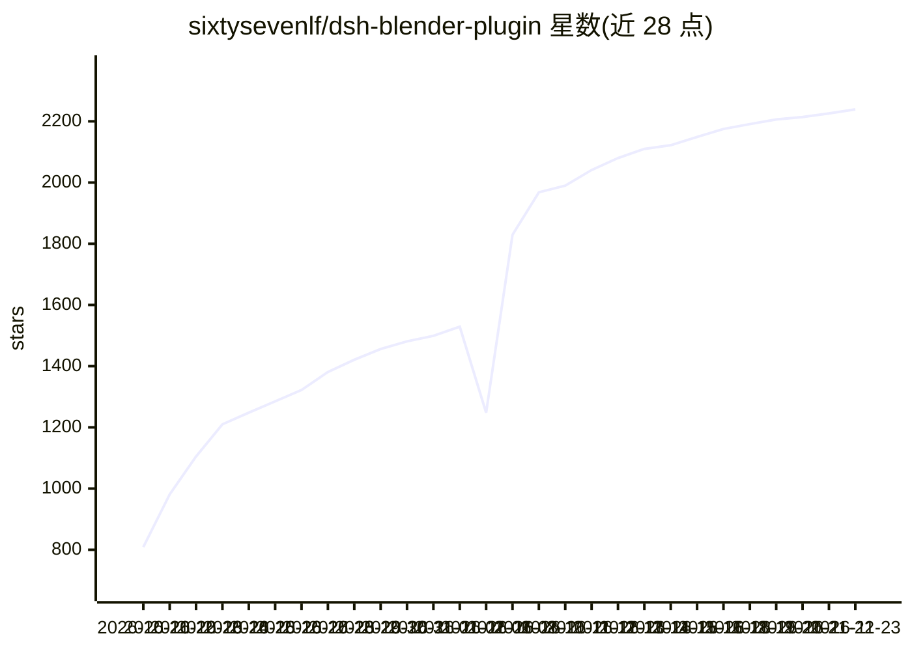

# sixtysevenlf/dsh-blender-plugin

⭐ 2,239 · Python · BSD-3-Clause · 推送 2026-11-18 · [GitHub](https://github.com/sixtysevenlf/dsh-blender-plugin) · 个人维护 · 中文 README

**让 DSH agent 在真实 Blender 会话中建模的工具插件**

将 DeepSeek Harness 接入 Blender 的插件：agent 通过 6 个模型面工具（session/op/py/see/run/inspect）驱动 GUI 会话，读写场景、截取视口帧、提交渲染或无头作业；能力目录为 34 family / 228 op 契约层，支持事务快照回滚、装配审计、参数化曲面与 GLB/FBX/OBJ 导出。GUI 优先，无 GUI 时走 headless 作业路径；随包附带建模 skill，支持 npm 安装或源码构建。

## 筛选速览

| 维度 | 判定 | 备注 |
|---|---|---|
| AI 角色 | `ai-ecosystem` | LLM/agent 周边工具 |
| 许可风险 | `permissive` | BSD-3-Clause |
| 部署形态 | `desktop` | 安装包/桌面程序 |
| 模型依赖 | locked-api |  |
| 硬件要求 | — | 无带数字的原话,不猜 |
| 安装摩擦 | `low` | 无编译、无系统依赖或容器化 |
| 成熟度 | — | 结构信号不足 |

## 能力要点

- 6 个模型面工具，228 个 op 契约化能力目录
- GUI 交互优先，headless 作业路径返回渲染帧
- 事务快照/标记回滚与交付门（defect gate）
- dsh-TUI 选中 chip、@ 提及与 /blender 命令

## 适用场景

- 让 agent 在真实 Blender 会话中逐步建模并验证
- 无 GUI 环境提交批量渲染或脚本作业
- 装配体检、碰撞分类与自动修复后导出模型
- 为视频模型生成 turntable 参考素材

## 场景标签

`GUI 自动化` `图像生成` · 领域:效率与自动化

## 证据(README 行号)

> L5: DSH × Blender connects DeepSeek Harness to Blender so an agent can build, inspect, validate, and export 3D scenes in
> L28: - DSH (DeepSeek Harness) installed and working.
> L143: The plugin exposes exactly 6 model-facing tools; all planning, audit, assembly, export, and evaluation operations 

## 星数曲线

2026-10-21 809 → 2026-11-23 2,239（+1,430）

---
*卡片 v1 · prompt 1.4 · 生成 2026-11-23 · 置信度 high · 依据 README sha `6223aff6443f` · [字段定义](../../DATASET.md)*
