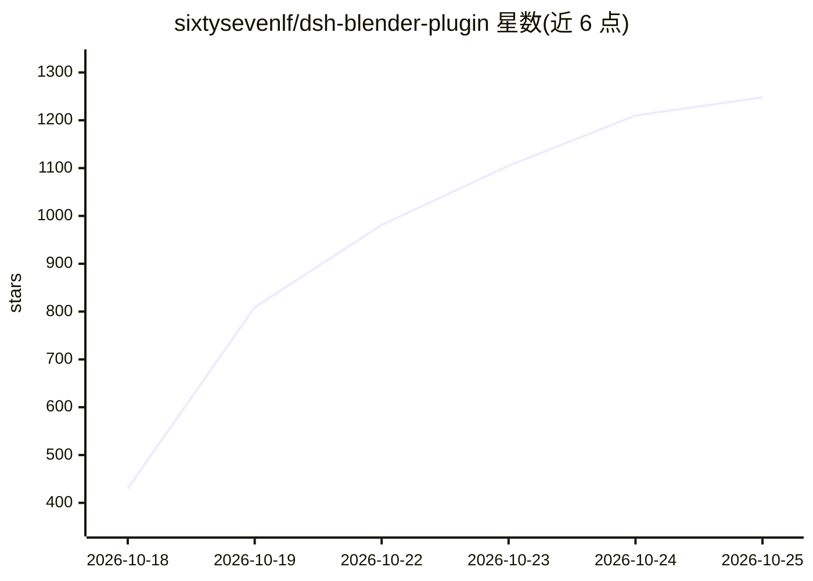

# sixtysevenlf/dsh-blender-plugin

⭐ 1,285 · Python · BSD-3-Clause · 推送 2026-10-25 · [GitHub](https://github.com/sixtysevenlf/dsh-blender-plugin) · 个人维护 · 中文 README

**让 AI 模型实时驱动 GUI Blender 的 DSH 插件（15 个模型工具）**

面向 DSH（DeepSeek Harness）的 Blender 直连插件：提供 15 个模型工具（视口取景、执行验证、无头会话、规划器 33 family/217 op、事务快照、参考图量具、装配扫描等），让模型在 GUI Blender 会话中'看-改-验'，无头模式为备用路径。附带 blender-modeling 技能包并可注册到 DSH 技能目录。用户可在 Blender 中原生选中对象一键送入 DSH 草稿。要求 Blender 4.x/5.x、Node.js ≥20 与 DSH 宿主，支持 WSL/Windows/macOS；上游 MCP for Blender 插件自 v2.3 起不被支持。

## 筛选速览

| 维度 | 判定 | 备注 |
|---|---|---|
| AI 角色 | `ai-ecosystem` | LLM/agent 周边工具 |
| 许可风险 | `permissive` | BSD-3-Clause |
| 部署形态 | `library` | 以包/库形式分发 |
| 模型依赖 | locked-api |  |
| 硬件要求 | — | 无带数字的原话,不猜 |
| 安装摩擦 | `medium` | 含编译或系统依赖之一 |
| 成熟度 | — | 结构信号不足 |

## 能力要点

- 15 个模型工具：视口取景 55–160 ms、exec 0–2 ms、内环搜索 160 ticks/s
- 无头交互会话：持久 blender -b 进程，see 往返 53–85 ms，空闲 15 分钟回收
- 随包 blender-modeling 技能（rank 600），非 DSH 宿主可复制为 SKILL.md
- 原生选中/集合/子元素直送 DSH 当前草稿，活动状态 idle/human/agent/both

## 适用场景

- 让 DSH 中的模型在真实 Blender 会话里建模并逐步验证效果
- 无 GUI/批处理场景下用无头会话执行多视角渲染等重活
- 用参考图量具从照片提取比例数据辅助重建模型
- 装配检查：全对分类 clash/contact/gap 等

## 场景标签

`GUI 自动化` · 领域:效率与自动化

## 证据(README 行号)

> L72: 4. **DSH (DeepSeek Harness)** — this package is a DSH plugin (`inject: ['tools']`, declares `dsh.bundle`). WSL host
> L14: > 15 model tools, no MCP assembly, no CLI adapter; and **you** can select objects natively in Blender and push them

## 星数曲线

2026-10-18 430 → 2026-10-25 1,248（+818）

---
*卡片 v1 · prompt 1.4 · 生成 2026-10-21 · 置信度 high · 依据 README sha `1eaa45243e9f` · [字段定义](../../DATASET.md)*
