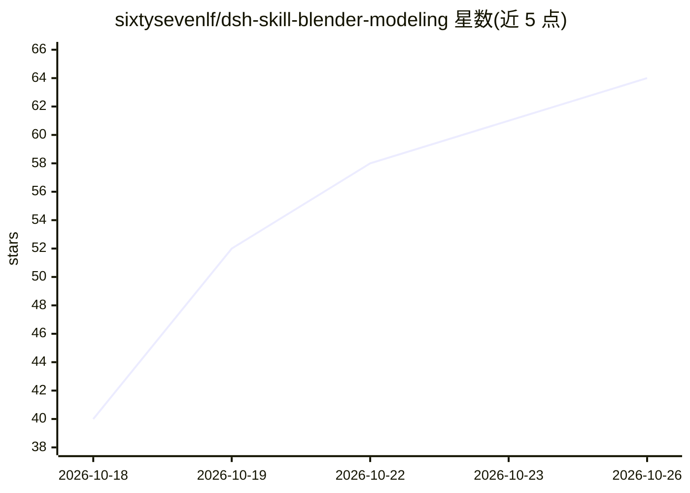

# sixtysevenlf/dsh-skill-blender-modeling

⭐ 64 · NOASSERTION · 推送 2026-10-04 · [GitHub](https://github.com/sixtysevenlf/dsh-skill-blender-modeling) · 个人维护 · 中文 README

**给 AI agent 读的 Blender 建模流程技能文档（SKILL.md）**

一份 Claude 风格的 agent skill（SKILL.md 目录）：把 Blender 建模与多 agent 装配写成可执行流程与可跑判据，覆盖 12 类建模类型指路、23 条配方（基本体到人形素体、放样、多步链）、六条实测坑、十道数值门装配审计与三态判定；多 agent 分工依赖冻结 spec、接口表与写作用域协议。工具调用依赖配套插件 dsh-blender-plugin（blender_rt_* 直连链）。安装为 git clone 后放入 skills 目录，派生自两个 MIT 上游项目。

## 筛选速览

| 维度 | 判定 | 备注 |
|---|---|---|
| AI 角色 | `ai-knowledge` | 知识聚合/清单类 |
| 许可风险 | `permissive` | NOASSERTION |
| 部署形态 | `None` |  |
| 模型依赖 | — | README 未给出锁定关系 |
| 硬件要求 | — | 无带数字的原话,不猜 |
| 安装摩擦 | `low` | 无编译、无系统依赖或容器化 |
| 成熟度 | — | 结构信号不足 |

## 能力要点

- 12 类建模类型的工具指路与三条硬规则
- 23 条配方 + 五条参数化生成脚本接 generator_save/run
- 十道数值门 + pass/fail/degraded 三态验收回执
- 多 Agent 分工范式：冻结 spec.py、接口表五要素、归属标签与并行判据

## 适用场景

- 让 Claude 类 agent 按 SKILL.md 流程执行 Blender 建模任务
- 多个 agent 并行建模后按数值门做装配审计
- 按参考图三视图标定做形体还原与双证据验收

## 场景标签

 · 领域:3D 建模/agent 技能

## 证据(README 行号)

> L3: > **Blender 建模与装配流程 skill**（DSH / Claude 风格的 `skills/<name>/SKILL.md` 目录）· **v1.0**
> L10: 一份**给 AI agent 读的建模作业指导书**：先按决策树选形，再走流水线，每一步都要有画面或数字证据。

## 星数曲线

2026-10-18 40 → 2026-10-26 64（+24）

---
*卡片 v1 · prompt 1.4 · 生成 2026-10-24 · 置信度 high · 依据 README sha `7a06785fb4a0` · [字段定义](../../DATASET.md)*
