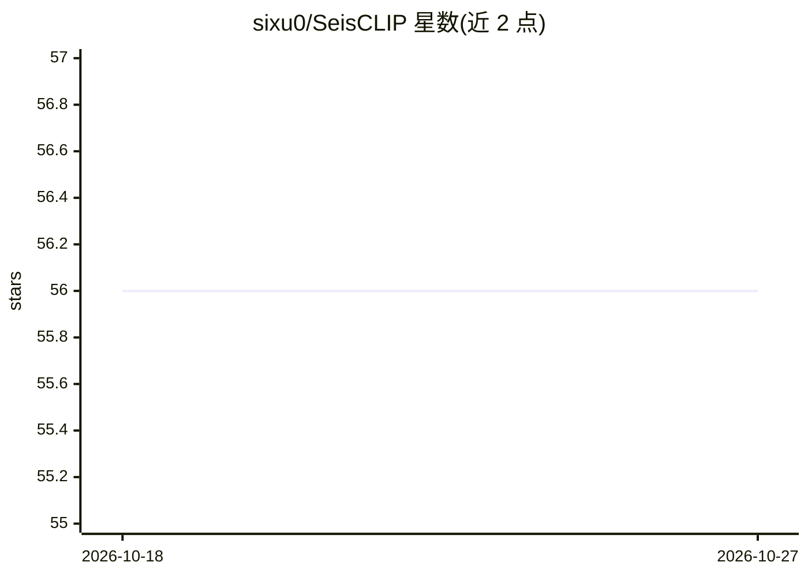

# sixu0/SeisCLIP

⭐ 56 · Jupyter Notebook · MIT · 推送 2025-11-26 · [GitHub](https://github.com/sixu0/SeisCLIP) · [官网](https://ieeexplore.ieee.org/document/10400506) · 组织维护 · 中文 README

**地震学基础模型：多模态预训练支持多任务地震特征提取**

论文 SeisCLIP 的官方代码仓库，作者来自中国科学技术大学。SeisCLIP 是在 STEAD-1M 数据集上以多模态方式预训练的地震学基础模型，可用于事件分类、定位、震源机制等下游任务的地震特征提取。仓库提供模型库（两种谱尺寸的预训练权重下载，含国内下载源）与事件分类的实现；定位与震源机制分析代码依赖 PyTorch_geometric，作者声明将后续发布更详细文档。位置与震源机制数据集因 hinet 数据传输限制未公开，需经百度网盘获取。

## 筛选速览

| 维度 | 判定 | 备注 |
|---|---|---|
| AI 角色 | `ai-native` | 本体是模型或模型工具 |
| 许可风险 | `permissive` | MIT |
| 部署形态 | `None` |  |
| 模型依赖 | — | README 未给出锁定关系 |
| 硬件要求 | — | 无带数字的原话,不猜 |
| 安装摩擦 | `low` | 无编译、无系统依赖或容器化 |
| 成熟度 | — | 结构信号不足 |

## 能力要点

- 多模态预训练的地震学基础模型（论文发表于 IEEE TGRS）
- 支持事件分类、定位、震源机制等下游任务
- 提供两种谱尺寸（50×120 / 50×600）预训练权重及国内下载源
- 推荐 Python 3.9.0，事件分类实现已发布

## 适用场景

- 我在做地震事件分类任务，想用预训练基础模型提取特征
- 我需要地震波形的通用表示用于定位或震源机制研究
- 我想复现论文实验或基于预训练权重微调

## 场景标签

`多模态` · 领域:感知与多模态

## 证据(README 行号)

> L21: ### 🌟 Spec-based Foundation Model Supports A Wide Range of Seismology
> L23:  As shown in this figure, SeisCLIP can provide services for downstream tasks including event classification 💥 , loc
> L31: * **2023.9.14:** 🌟🌟🌟 Pretrained weight and a simple usage demo for out SeisCLIP have been released. The implementat

## 星数曲线

2026-10-18 56 → 2026-10-27 56（+0）

---
*卡片 v1 · prompt 1.4 · 生成 2026-10-24 · 置信度 high · 依据 README sha `acc81d073977` · [字段定义](../../DATASET.md)*
