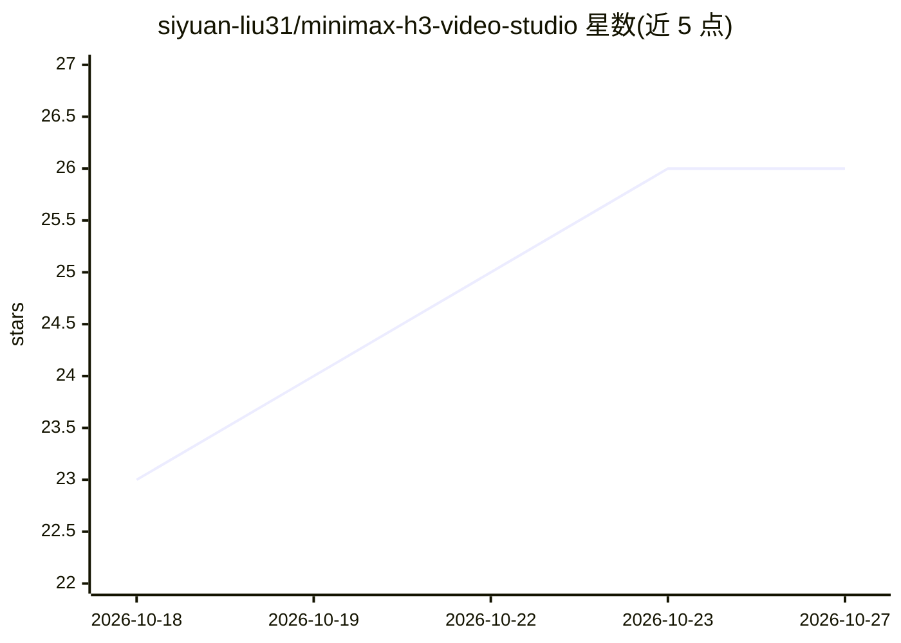

# siyuan-liu31/minimax-h3-video-studio

⭐ 26 · Python · 推送 2026-10-24 · [GitHub](https://github.com/siyuan-liu31/minimax-h3-video-studio) · 个人维护 · 中文 README

**面向 MiniMax H3 的自托管 AI 视频创作工作台（浏览器 + CLI）**

自托管的视觉创作工作区：围绕 MiniMax H3 视频模型提供文生视频、图生视频、首尾帧、多模态参考、源视频重制等 7 种视频模式与分段长视频生成；图像部分接入本地/远程 ComfyUI 模型（Z-Image Turbo、Qwen-Image 2.1、FLUX.2 Klein 等）或 GPT Image、Nano Banana、OpenRouter 等外部 API；音频部分提供语音转换、歌词转写改写与翻唱（YingMusic/SoulX/ACE-Step 等引擎）。同一后端可通过浏览器画布或 h3ctl CLI/Agent 调用，任务支持持久化 ID、断线重连与分段重跑。仓库不含模型权重与生成媒体，能力取决于所配置的模型、运行时与外部服务凭据。

## 筛选速览

| 维度 | 判定 | 备注 |
|---|---|---|
| AI 角色 | `ai-native` | 本体是模型或模型工具 |
| 许可风险 | `none` | — |
| 部署形态 | `None` |  |
| 模型依赖 | — | README 未给出锁定关系 |
| 硬件要求 | — | 无带数字的原话,不猜 |
| 安装摩擦 | `medium` | 含编译或系统依赖之一 |
| 成熟度 | — | 结构信号不足 |

## 能力要点

- H3 视频节点 7 种模式（T2V/I2V/FL2V/R2V/V2V/RV2V/Auto），支持 124–362 帧分段与续写
- 多模型图像生成/编辑：本地 ComfyUI 或 GPT Image、Nano Banana、OpenRouter 等外部 API
- 音频引擎覆盖语音转换、人声分离、歌词转写改写与整曲翻唱
- 同一后端双入口：浏览器节点画布 + h3ctl CLI，可供 Agent 以 shell 调用

## 适用场景

- 用文本、图片或参考素材生成带原生音频的短视频并拼成长片
- 翻唱歌曲：转写歌词、替换演唱者音色并导出人声/伴奏分轨
- 让 Agent 通过 h3ctl 命令行提交、等待并下载生成任务
- 在本地 ComfyUI 或外部图像 API 之间选择生成运行位置

## 场景标签

`视频生成` `图像生成` `工作流自动化` · 领域:效率与自动化

## 证据(README 行号)

> L20: MiniMax H3 Video Studio brings video generation, image creation, voice conversion, and lyric rewriting into one sel
> L26: |**Video**|Generate video with native audio from text, keyframes, or image/video/audio references; remake source fo
> L33: Use the **browser studio** to compose node workflows, manage references, review video timelines, edit lyrics, and a

## 星数曲线

2026-10-18 23 → 2026-10-27 26（+3）

---
*卡片 v1 · prompt 1.4 · 生成 2026-10-26 · 置信度 high · 依据 README sha `8a2b81997091` · [字段定义](../../DATASET.md)*
