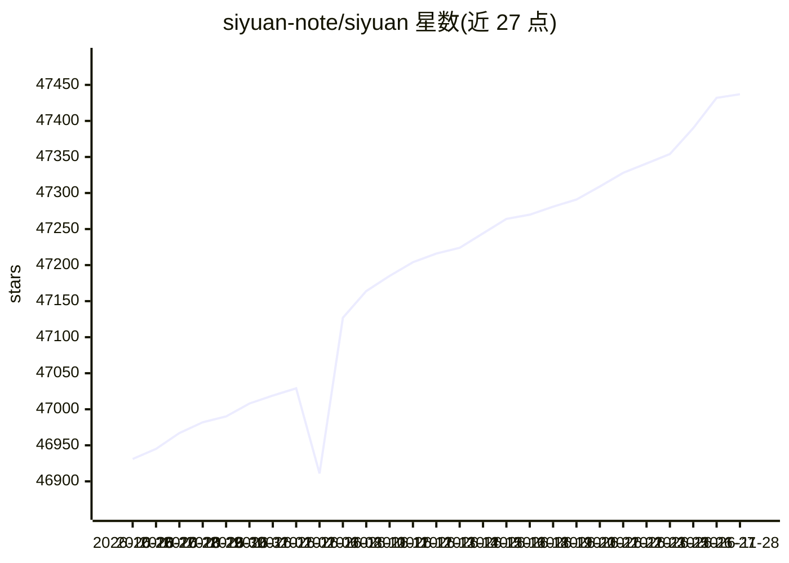

# siyuan-note/siyuan

⭐ 47,437 · TypeScript · AGPL-3.0 · 推送 2026-11-27 · [GitHub](https://github.com/siyuan-note/siyuan) · [官网](https://b3log.org/siyuan) · 组织维护 · 中文 README

**隐私优先的自托管个人知识管理与笔记工作空间**

以块级引用和双向链接为核心的个人知识管理系统，编辑器支持 Markdown 所见即所得、百万字大文档、数学公式与多种图表，内置 SQL 查询、数据库表格视图、间隔重复记忆卡、Tesseract OCR，并通过 OpenAI API 提供 AI 写作与问答聊天。支持 Android/iOS/HarmonyOS 应用、桌面安装包、包管理器与 Docker/Kubernetes 部署，提供 API 与社区插件市场。多数功能免费，部分功能仅面向付费会员。

## 筛选速览

| 维度 | 判定 | 备注 |
|---|---|---|
| AI 角色 | `ai-enhanced` | 去掉 AI 部分产品仍成立 |
| 许可风险 | `viral` | AGPL-3.0 |
| 部署形态 | `desktop` | 安装包/桌面程序 |
| 模型依赖 | — | README 未给出锁定关系 |
| 硬件要求 | — | 无带数字的原话,不猜 |
| 安装摩擦 | `low` | 无编译、无系统依赖或容器化 |
| 成熟度 | — | 结构信号不足 |

## 动量与使用信号

- 维护:`active` — 距上次 push 0.6 天,年发版 100,124 位贡献者
- 涨星:近 1 天 **+16**(自 20261016 起算)
- 平台:ANDROID / IOS · 协议:OPENAI-API

## 能力要点

- 块级引用、双向链接与 SQL 查询嵌入
- 通过 OpenAI API 进行 AI 写作与问答聊天
- 支持 Docker 与 Kubernetes（社区 Helm chart）部署
- 多端应用覆盖 Android/iOS/HarmonyOS 与桌面

## 适用场景

- 自托管搭建个人知识库并做块级笔记管理
- 在笔记中直接调用 OpenAI API 进行写作与问答
- Docker 部署服务器端并配置 OIDC 登录认证

## 场景标签

`知识库管理` · 领域:知识与检索

## 证据(README 行号)

> L20: SiYuan is a privacy-first personal knowledge management system, supporting fine-grained block-level reference and M
> L55: - AI writing and Q/A chat via OpenAI API

## 星数曲线

2026-10-26 46,931 → 2026-11-28 47,437（+506）

---
*卡片 v1 · prompt 1.4 · 生成 2026-11-26 · 置信度 high · 依据 README sha `4826d4efa862` · [字段定义](../../DATASET.md)*
