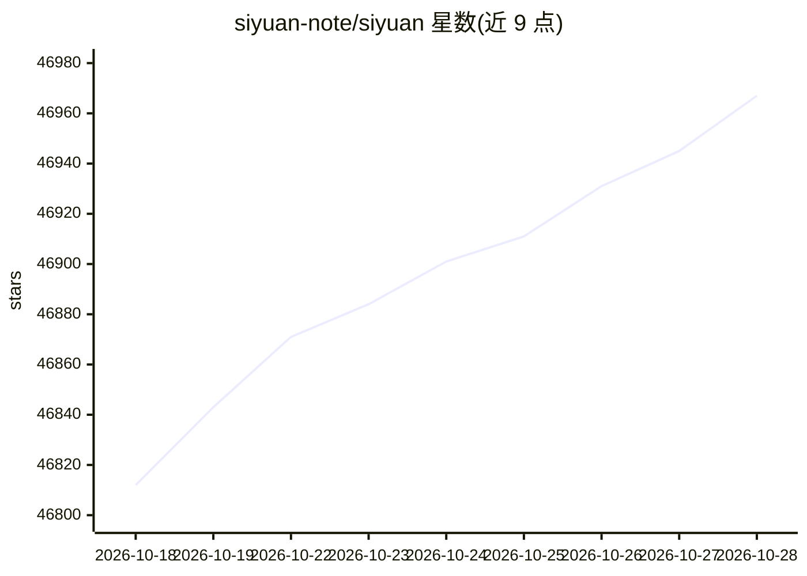

# siyuan-note/siyuan

⭐ 46,982 · TypeScript · AGPL-3.0 · 推送 2026-10-28 · [GitHub](https://github.com/siyuan-note/siyuan) · [官网](https://b3log.org/siyuan) · 组织维护 · 中文 README

**隐私优先自托管知识管理工具，人与 AI agent 协作**

思源笔记是一个隐私优先的个人知识管理系统，支持块级引用与 Markdown 所见即所得编辑，涵盖双向链接、SQL 查询嵌入、数据库表格视图、间隔重复闪卡、PDF 标注、导出为 PDF/Word/HTML 等功能。AI 方面通过 OpenAI API 提供写作与问答聊天，主题标签与项目描述表明支持 MCP 与 agent 协作场景。桌面端通过应用商店或安装包分发，移动端有 Android/iOS/HarmonyOS 应用，服务端提供 Docker 部署与社区维护的 Helm chart，部分功能仅对付费会员开放。

## 筛选速览

| 维度 | 判定 | 备注 |
|---|---|---|
| AI 角色 | `ai-enhanced` | 去掉 AI 部分产品仍成立 |
| 许可风险 | `viral` | AGPL-3.0 |
| 部署形态 | `desktop` | 安装包/桌面程序 |
| 模型依赖 | — | README 未给出锁定关系 |
| 硬件要求 | — | 无带数字的原话,不猜 |
| 安装摩擦 | `low` | 无编译、无系统依赖或容器化 |
| 成熟度 | — | 结构信号不足 |

## 动量与使用信号

- 维护:`active` — 距上次 push 0.6 天,年发版 100,124 位贡献者
- 涨星:近 1 天 **+16**(自 20261016 起算)
- 平台:ANDROID / IOS · 协议:OPENAI-API

## 能力要点

- 块级引用、双向链接与 SQL 查询嵌入的内容块体系
- 通过 OpenAI API 提供 AI 写作与问答聊天
- Docker 部署支持 PUID/PGID 权限配置与 OIDC 认证
- 多端应用：Android/iOS/HarmonyOS 与桌面安装包

## 适用场景

- 自托管搭建个人知识库并做块级笔记管理
- 在笔记中调用 AI 进行写作与问答
- 通过 Docker 在服务器上部署浏览器访问的知识工作空间

## 场景标签

`知识库管理` `AI 写作` · 领域:内容生成

## 证据(README 行号)

> L18: SiYuan is a privacy-first personal knowledge management system, supporting fine-grained block-level reference and M
> L53: - AI writing and Q/A chat via OpenAI API
> L59: - Docker deployment

## 星数曲线

2026-10-18 46,812 → 2026-10-28 46,967（+155）

---
*卡片 v1 · prompt 1.4 · 生成 2026-10-18 · 置信度 mid · 依据 README sha `ba0e97beeeed` · [字段定义](../../DATASET.md)*
