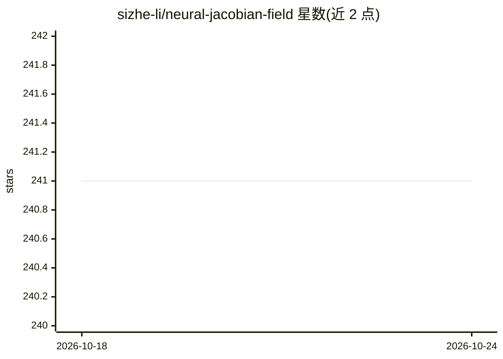

# sizhe-li/neural-jacobian-field

⭐ 242 · Jupyter Notebook · NOASSERTION · 推送 2026-07-21 · [GitHub](https://github.com/sizhe-li/neural-jacobian-field) · [官网](https://sizhe-li.github.io/publication/neural_jacobian_field/) · 组织维护

**科研者的神经雅可比场：从感知学习机器人系统表示以控制机器人**

Neural Jacobian Fields 论文（Nature 2025）的官方实现：用深度网络从多视角视频与动作数据推断机器人的雅可比场，作为可从感知学习的通用机器人系统表示，用于逆动力学优化与机器人控制。提供 3D/2D 两种实现与自定义 MuJoCo 仿真器，附教程笔记本、预训练权重与两个 HuggingFace 数据集（Allegro 手等四种机器人平台）。安装需 Conda + install.sh（含 PyTorch、Nerfstudio、TinyCudaNN），训练需多 GPU（A8000/A100），本地推理可用单张 RTX 4090。

## 筛选速览

| 维度 | 判定 | 备注 |
|---|---|---|
| AI 角色 | `ai-native` | 本体是模型或模型工具 |
| 许可风险 | `none` | NOASSERTION |
| 部署形态 | `None` |  |
| 模型依赖 | — | README 未给出锁定关系 |
| 硬件要求 | — | 无带数字的原话,不猜 |
| 安装摩擦 | `low` | 无编译、无系统依赖或容器化 |
| 成熟度 | — | 结构信号不足 |

## 能力要点

- 3D 与 2D Jacobian Field 实现及自定义 MuJoCo 仿真器
- HuggingFace 提供 Allegro-Only 轻量版与完整多视角视频-动作数据集
- 教程笔记本（2D，约 30 分钟）与预训练权重下载
- 支持多 GPU 训练，光学流（RAFT）与 track 两种监督方式

## 适用场景

- 研究者在仿真或真实机器人上训练雅可比场
- 复现论文实验并可视化雅可比场
- 为机器人控制做逆动力学优化

## 场景标签

`科研工具` `教程课程` · 领域:学习与行业

## 证据(README 行号)

> L6: > [TL;DR] Neural Jacobian Fields are a general-purpose representation of robotic systems that can be learned from pe
> L23: We provide the software implementations of:
> L24: - 🧠 3D Jacobian Field: `project/neural_jacobian_field`

## 星数曲线

2026-10-18 241 → 2026-10-24 241（+0）

---
*卡片 v1 · prompt 1.4 · 生成 2026-10-22 · 置信度 high · 依据 README sha `0c954791e26b` · [字段定义](../../DATASET.md)*
