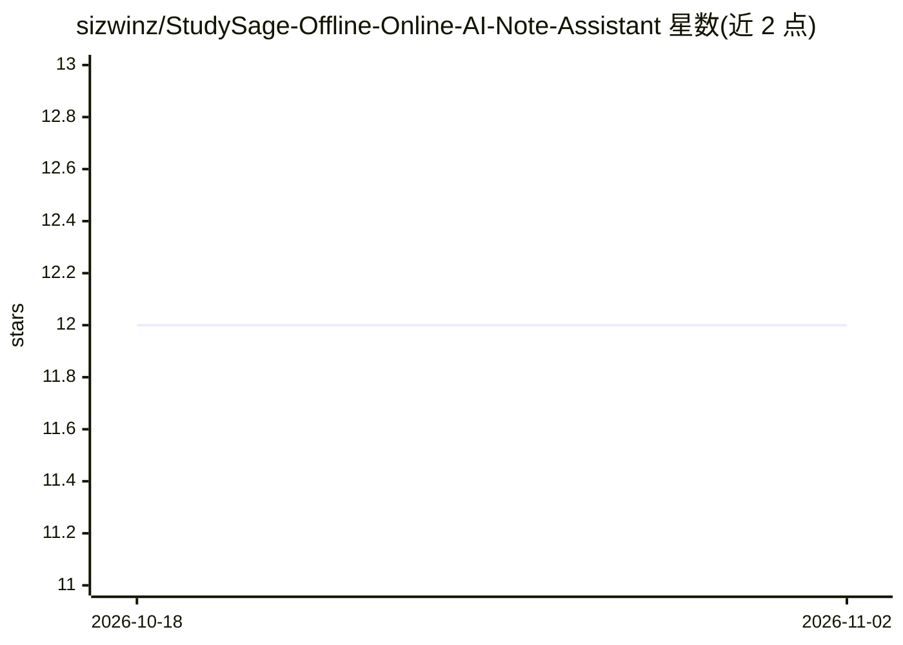

# sizwinz/StudySage-Offline-Online-AI-Note-Assistant

⭐ 12 · Python · MIT · 推送 2026-07-05 · [GitHub](https://github.com/sizwinz/StudySage-Offline-Online-AI-Note-Assistant) · [官网](https://studysage-sahaj33.streamlit.app/) · 个人维护

**面向学生的离线/在线 AI 笔记助手：摘要、测验、OCR、PDF 导出**

面向学生的 AI 学习助手：把原始笔记、扫描讲义和截图转化为结构化学习指南、摘要和交互式选择题。本地摘要使用 Seq2Seq 模型（distilbart），也可经 Hugging Face Inference API 在线调用；OCR 采用 OpenCV 预处理管线加 Tesseract，自动检测语言；支持导出浅色与深色主题的 A4 PDF 报告。提供 React SPA、Streamlit、CustomTkinter 桌面端、Telegram 机器人和 CLI 五种界面。离线模式数据完全本地处理，文档上限约 20,000 词；在线模式单次约 800 词/4,000 字符。

## 筛选速览

| 维度 | 判定 | 备注 |
|---|---|---|
| AI 角色 | `ai-native` | 本体是模型或模型工具 |
| 许可风险 | `permissive` | MIT |
| 部署形态 | `library` | 以包/库形式分发 |
| 模型依赖 | — | README 未给出锁定关系 |
| 硬件要求 | — | 无带数字的原话,不猜 |
| 安装摩擦 | `low` | 无编译、无系统依赖或容器化 |
| 成熟度 | — | 结构信号不足 |

## 能力要点

- 五种界面：React SPA、Streamlit、桌面 GUI、Telegram Bot、CLI
- 本地 distilbart 摘要或 Hugging Face Inference API 在线摘要
- OpenCV 预处理 + Tesseract OCR 自动语言检测
- 摘要与测验导出为 A4 PDF 报告（浅色/深色主题）

## 适用场景

- 把课堂笔记和讲义扫描件整理成学习指南与摘要
- 自动生成选择题并交互式自测
- 离线保护隐私地处理学习材料并导出 PDF

## 场景标签

`OCR` `知识库管理` `AI 写作` · 领域:内容生成

## 证据(README 行号)

> L16: **StudySage** is a high-fidelity, privacy-first AI study assistant. It helps you transform raw notes, scanned lectu
> L22: - **Smart Summarization**: Summarize large documents locally using a Seq2Seq transformer model (`distilbart`) or on
> L24: - **Advanced OCR Engine**: Preprocesses screen captures using an adaptive OpenCV pipeline (denoising, grayscaling, 

## 星数曲线

2026-10-18 12 → 2026-11-02 12（+0）

---
*卡片 v1 · prompt 1.4 · 生成 2026-11-01 · 置信度 mid · 依据 README sha `8bac655effb3` · [字段定义](../../DATASET.md)*
