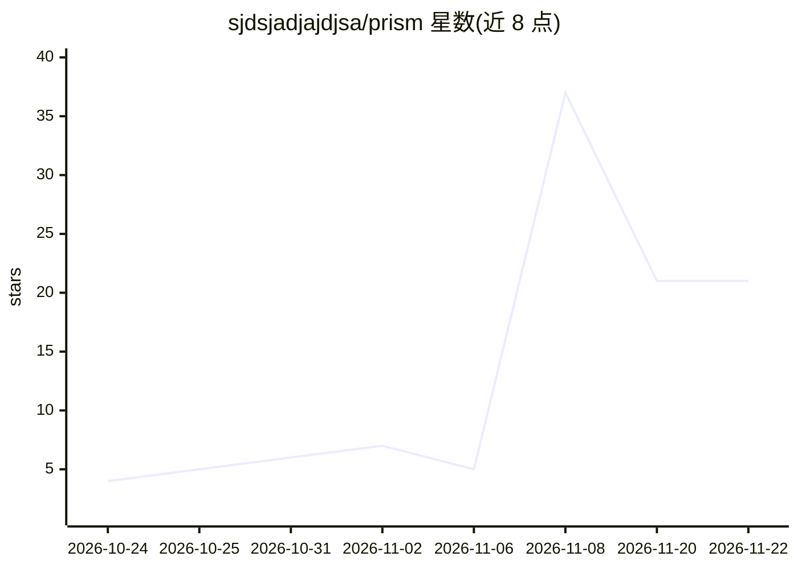

# sjdsjadjajdjsa/prism

⭐ 21 · Go · MIT · 推送 2026-11-02 · [GitHub](https://github.com/sjdsjadjajdjsa/prism) · [官网](https://github.com/sjdsjadjajdjsa/prism/blob/main/docs/GUIDE.md) · 个人维护

**免费终端/浏览器 AI 编码助手，跑免费模型或已有订阅**

面向开发者的终端与浏览器编码助手：读取代码、编辑文件、运行命令并在浏览器中点击自检生成的网页。模型来源分三层：无 key 免费模型（Kilo Gateway/BlockRun/LLM7，路由并行竞速）、免费 key 服务（NVIDIA/Groq/Ollama 等）以及通过 /login 接入已有的 ChatGPT/Claude/Grok/Copilot 订阅。整个路由与 agent 运行在 Docker 内，仅挂载当前项目文件夹；Docker 为必需依赖。支持 MCP 工具服务器、24 个内置技能与项目记忆。

## 筛选速览

| 维度 | 判定 | 备注 |
|---|---|---|
| AI 角色 | `ai-native` | 本体是模型或模型工具 |
| 许可风险 | `permissive` | MIT |
| 部署形态 | `self-host` | docker 或自建部署 |
| 模型依赖 | local-ok | 支持本地模型 |
| 硬件要求 | — | 无带数字的原话,不猜 |
| 安装摩擦 | `low` | 无编译、无系统依赖或容器化 |
| 成熟度 | — | 结构信号不足 |

## 能力要点

- 路由同时竞速最多 3 个免费模型，取最先返回者
- 运行于 Docker，仅可见启动目录，127.0.0.1 监听
- /login 接入 ChatGPT/Claude/Grok/Copilot 既有订阅
- 终端与浏览器同会话，含文件树、编辑器与 MCP 工具服务器

## 适用场景

- 在终端里让 AI 写代码、改 bug 并自检
- 不想付订阅费时用免费模型完成编码任务
- 复用已付费的 ChatGPT/Claude 等 plan 做编码

## 场景标签

`编码 Agent` · 领域:编码与开发

## 证据(README 行号)

> L3:  A coding assistant for your terminal and browser that runs on free AI models, or on the ChatGPT, Claude, Grok, Gemi
> L21: Prism reads your code, edits files, runs commands and checks its own work. When it builds a web page, it opens it i
> L83:  Free with no key: Kilo Gateway, BlockRun, LLM7. Free with a free key: NVIDIA, Groq, Google AI Studio, Mistral, Ope

## 星数曲线

2026-10-24 4 → 2026-11-22 21（+17）

---
*卡片 v1 · prompt 1.4 · 生成 2026-11-18 · 置信度 high · 依据 README sha `2eb4b1736484` · [字段定义](../../DATASET.md)*
