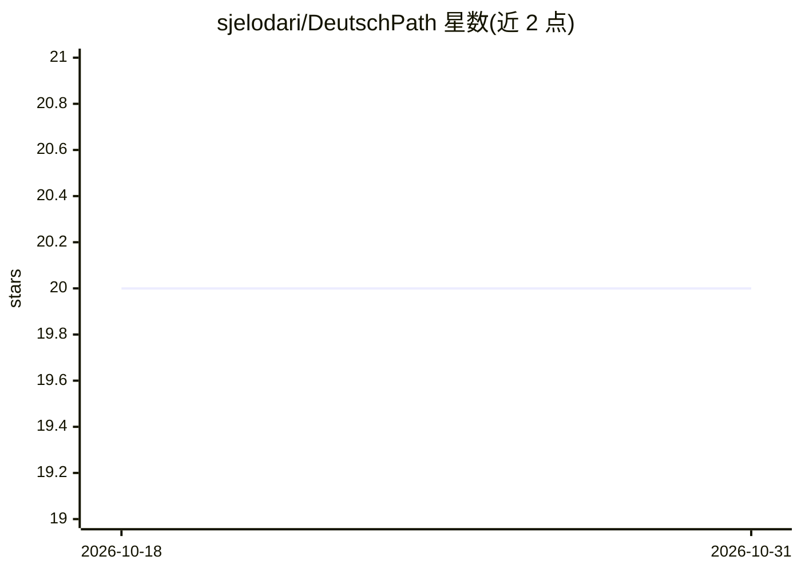

# sjelodari/DeutschPath

⭐ 20 · TypeScript · NOASSERTION · 推送 2026-07-06 · [GitHub](https://github.com/sjelodari/DeutschPath) · 个人维护

**本地优先的德语学习平台：AI 导师、词汇复习与写作批改**

面向德语学习者的本地优先应用，数据存于本机 SQLite 文件。功能包括 PDF 书籍阅读（词/短语分析、Gemini Vision OCR 扫描页）、基于 SM-2 算法的间隔重复词汇复习、A1→C2 语法路线图、10 个角色扮演对话场景、带 diff 批改的写作练习和变格参考。AI 能力依赖 Google Gemini 2.5 Flash（需自备 API key，免费层有速率限制，TTS 模型无免费层）。技术栈为 FastAPI 后端 + Next.js 前端，macOS/Windows 提供双击启动脚本自动安装依赖。采用 AGPL v3 + 商业双许可。

## 筛选速览

| 维度 | 判定 | 备注 |
|---|---|---|
| AI 角色 | `ai-native` | 本体是模型或模型工具 |
| 许可风险 | `none` | NOASSERTION |
| 部署形态 | `library` | 以包/库形式分发 |
| 模型依赖 | — | README 未给出锁定关系 |
| 硬件要求 | — | 无带数字的原话,不猜 |
| 安装摩擦 | `low` | 无编译、无系统依赖或容器化 |
| 成熟度 | — | 结构信号不足 |

## 能力要点

- 上传德语 PDF（含扫描件 OCR），划词分析词性、变格与 CEFR 等级
- SM-2 算法间隔重复词汇复习与 3 按钮流程
- 10 个角色扮演语音对话场景，AI 按角色与 CEFR 等级适配
- 写作批改带 diff 高亮与错误类型分类（语法/拼写/标点/选词/风格）

## 适用场景

- 上传自己的德语原版书边读边学并收藏生词
- 通过角色扮演语音对话练习日常德语场景
- 按 A1→C2 路线系统学习语法并做写作批改
- 在不出网、无订阅的前提下本地使用 AI 德语导师

## 场景标签

`语音 Agent` `OCR` · 领域:对话与助手

## 证据(README 行号)

> L16: Upload real German books, annotate words and grammar, chat with an AI tutor,
> L131: |**AI — text**|Google Gemini 2.5 Flash|—|Analysis, chat, OCR, grammar, writing|

## 星数曲线

2026-10-18 20 → 2026-10-31 20（+0）

---
*卡片 v1 · prompt 1.4 · 生成 2026-10-28 · 置信度 mid · 依据 README sha `002f5d73000e` · [字段定义](../../DATASET.md)*
