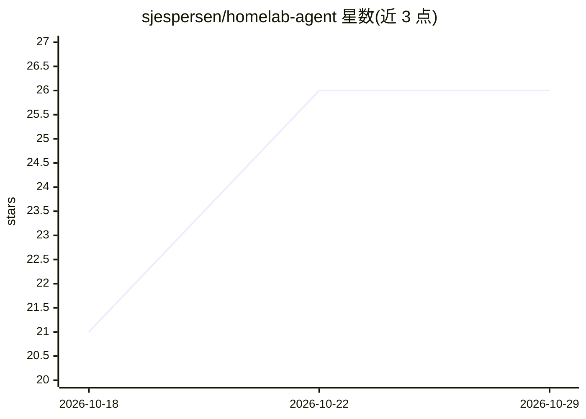

# sjespersen/homelab-agent

⭐ 26 · Shell · MIT · 推送 2026-10-27 · [GitHub](https://github.com/sjespersen/homelab-agent) · 个人维护

**把廉价主机变成常驻 AI agent 服务器的家庭实验室一体仓**

以 Infrastructure-as-Code 方式部署双栈自托管环境：agent 栈在 x86-64 小主机上运行 Hermes Agent（Telegram/WhatsApp 对话、代码与 GitHub 推送）、n8n 工作流、Pi-hole、Uptime Kuma、Beszel 监控、Tailscale 与 restic 加密备份；AI 栈在 NVIDIA GPU 服务器上本地运行 Qwen3.8-27B / Flash-Next、图像生成与 Ollama 网页聊天，统一暴露为 OpenAI 兼容 API 并可切换模型。setup.sh 一条命令完成部署，镜像按 digest 锁定，支持多服务器配置与月度更新回滚。README 声明这是家庭实验室而非加固生产环境。

## 筛选速览

| 维度 | 判定 | 备注 |
|---|---|---|
| AI 角色 | `ai-ecosystem` | LLM/agent 周边工具 |
| 许可风险 | `permissive` | MIT |
| 部署形态 | `self-host` | docker 或自建部署 |
| 模型依赖 | local-ok | 支持本地模型 |
| 硬件要求 | `gpu-8g` | |
| 安装摩擦 | `low` | 无编译、无系统依赖或容器化 |
| 成熟度 | — | 结构信号不足 |

## 能力要点

- 单命令 setup.sh 将全新 Ubuntu Server 变成完整服务栈，可重复执行与断点恢复
- 所有容器镜像按 digest 锁定，更新可回滚，备份由 restic 每夜加密拉取
- 本地模型（Qwen 27B/Flash-Next/图像生成/Ollama）统一为 OpenAI 兼容 API 且带切换页
- 模块化设计（MODULES 选择服务），每个服务除 Caddy 外均可选

## 适用场景

- 用一台二手小机搭建 24/7 在线的个人 AI agent 与其工具链
- 在自有 GPU 服务器上本地运行大模型并给 agent 提供替代云端的服务
- 按基础设施即代码方式管理、重建与更新家庭服务器集群

## 场景标签

`AI 助手` · 领域:对话与助手

## 证据(README 行号)

> L3: It started as a cheap used mini PC turned into an always-on AI agent server: the reference
> L9: Qwen3.8-Flash-Next, image generation, Ollama for the web chat) behind one OpenAI-compatible
> L23: |Local AI (llama.cpp, Strata, SwarmUI, Open WebUI, Ollama)|`ai.home.arpa`, `<server>:8005`; `swarm.home.arpa`, `<se

## 星数曲线

2026-10-18 21 → 2026-10-29 26（+5）

---
*卡片 v1 · prompt 1.4 · 生成 2026-10-26 · 置信度 mid · 依据 README sha `7b7bbf25a54e` · [字段定义](../../DATASET.md)*
