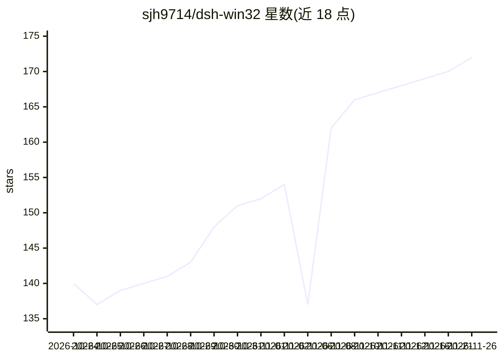

# sjh9714/dsh-win32

⭐ 172 · TypeScript · MIT · 推送 2026-11-23 · [GitHub](https://github.com/sjh9714/dsh-win32) · [官网](https://www.npmjs.com/package/dsh-win32) · 个人维护 · 中文 README

**在原生 Windows 上诊断与修复 DeepSeek Harness 环境的 CLI**

一个独立 npm CLI（dsh-win32），用于检查并修复 DeepSeek Harness（DSH）在原生 Windows 上的运行环境：校验官方持久 PowerShell 与 Workspace Write 包、检测已知损坏的 koffi 运行时并修复、创建桌面快捷方式。提供 setup/verify/doctor/fix/preflight 子命令，verify 在隔离临时环境中对已安装的 DSH 依赖树做无模型、无 API key 的实机验收。不安装 Git/PowerShell/WSL/DSH 本体，要求原生 Windows 与受支持 Node 版本（Node 23 不支持）。

## 筛选速览

| 维度 | 判定 | 备注 |
|---|---|---|
| AI 角色 | `ai-ecosystem` | LLM/agent 周边工具 |
| 许可风险 | `permissive` | MIT |
| 部署形态 | `library` | 以包/库形式分发 |
| 模型依赖 | locked-api |  |
| 硬件要求 | — | 无带数字的原话,不猜 |
| 安装摩擦 | `low` | 无编译、无系统依赖或容器化 |
| 成熟度 | — | 结构信号不足 |

## 能力要点

- setup/doctor/fix/verify/preflight 五个子命令的诊断-修复-验收流程
- verify 为无模型、无 API key 的组件链实机验收，输出 JSON 可选
- 仅修复已知损坏的 koffi 运行时版本，修复后重新验证加载
- preflight 支持跨平台只读检查目标 DSH 版本的插件/Node/Windows 兼容性

## 适用场景

- DSH 在 Windows 上无法启动或检查失败时按流程排查
- 升级 DSH 版本前预检插件与 Node 兼容性
- 对已安装的 DSH Windows 组件链做无密钥验收

## 场景标签

 · 领域:开发工具/环境诊断

## 证据(README 行号)

> L11: Current DeepSeek Harness already includes persistent PowerShell and a Windows ACL sandbox. dsh-win32 checks that of
> L72: `verify` is a model- and API-key-free acceptance run against an **already installed** `@deepseek-ai/dsh` dependency
> L93: The repository CI installs `@deepseek-ai/dsh@latest` from scratch and runs this acceptance on real Windows. Pushes,

## 星数曲线

2026-10-24 140 → 2026-11-26 172（+32）

---
*卡片 v1 · prompt 1.4 · 生成 2026-11-26 · 置信度 high · 依据 README sha `38922c0702af` · [字段定义](../../DATASET.md)*
