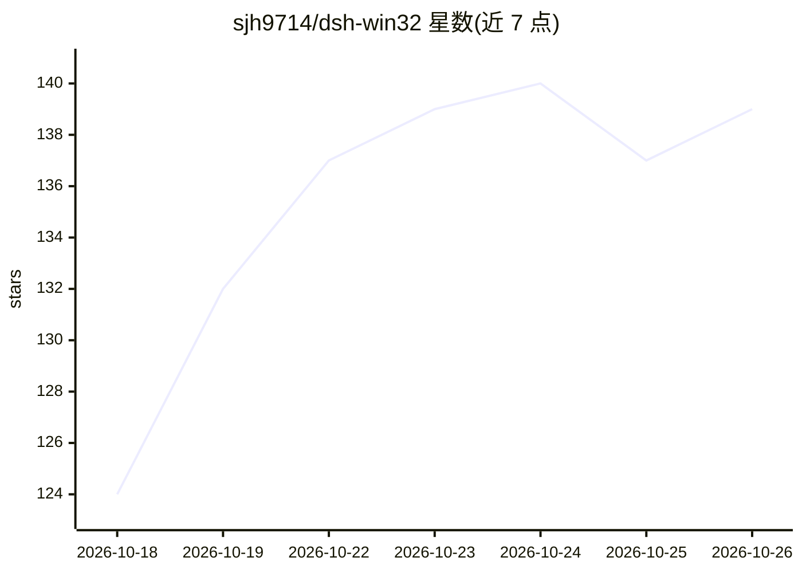

# sjh9714/dsh-win32

⭐ 139 · TypeScript · MIT · 推送 2026-10-20 · [GitHub](https://github.com/sjh9714/dsh-win32) · [官网](https://www.npmjs.com/package/dsh-win32) · 个人维护 · 中文 README

**在原生 Windows 上诊断并修复 DeepSeek Harness（DSH）的 CLI 工具**

面向 DeepSeek Harness（DSH）Windows 用户的诊断与修复命令行工具，通过 npx 运行，不依赖 WSL。提供四类命令：setup 检查官方持久 PowerShell 与 Workspace Write 包并创建桌面快捷方式；verify 在隔离环境中对已安装的 @deepseek-ai/dsh 组件链做无模型、无 API key 的实测验收（PTY 保持、沙箱外写拒绝、资源清理等）；doctor 基于包元数据检查已知故障；fix 仅修复已确认损坏的 koffi 版本。另含旧版 Git Bash/busybox 预设的显式兼容边界与备份机制，并明确列出多项不覆盖的验证边界（如钩子强制、端到端会话）。

## 筛选速览

| 维度 | 判定 | 备注 |
|---|---|---|
| AI 角色 | `ai-ecosystem` | LLM/agent 周边工具 |
| 许可风险 | `permissive` | MIT |
| 部署形态 | `library` | 以包/库形式分发 |
| 模型依赖 | locked-api |  |
| 硬件要求 | — | 无带数字的原话,不猜 |
| 安装摩擦 | `low` | 无编译、无系统依赖或容器化 |
| 成熟度 | — | 结构信号不足 |

## 能力要点

- setup/verify/doctor/fix 四命令覆盖检查、实测验收与安全修复
- verify 为无模型、无 API key 的组件链验收，含沙箱外写拒绝与资源清理观察
- 旧版预设重装前自动备份到 preset-backups，doctor 仅警告不删除
- README 明确列出多项不覆盖的边界（钩子强制、plugin add 路径处理、端到端会话）

## 适用场景

- DSH 在 Windows 上无法启动或检查失败时定位问题
- 升级 DSH 或修改钩子后验证沙箱与 PowerShell 持久化是否真正生效
- 停用或移除旧的 dsh-win32 legacy 插件捆绑包

## 场景标签

 · 领域:AI agent 工具链/Windows 运维

## 证据(README 行号)

> L11: Current DeepSeek Harness already includes persistent PowerShell and a Windows ACL sandbox. dsh-win32 checks that of
> L72: `verify` is a model- and API-key-free acceptance run against an **already installed** `@deepseek-ai/dsh` dependency

## 星数曲线

2026-10-18 124 → 2026-10-26 139（+15）

---
*卡片 v1 · prompt 1.4 · 生成 2026-10-22 · 置信度 high · 依据 README sha `bff460e7bd8d` · [字段定义](../../DATASET.md)*
