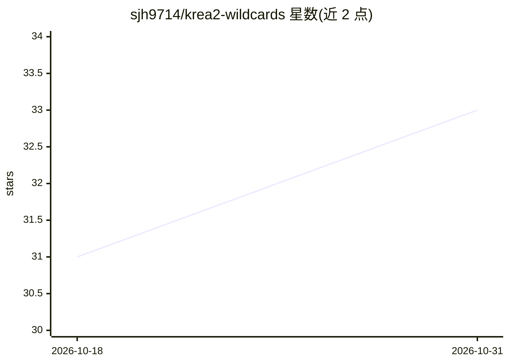

# sjh9714/krea2-wildcards

⭐ 33 · HTML · MIT · 推送 2026-09-06 · [GitHub](https://github.com/sjh9714/krea2-wildcards) · [官网](https://sjh9714.github.io/krea2-wildcards/) · 个人维护

**514 条 Krea 2 Turbo 提示词库，附生成图与 ComfyUI wildcards**

收录 514 条 Krea 2 Turbo 提示词的数据集：每条附未经修饰的 AI 生成图、完整提示文本与生成 seed 或资源 ID，按 61 个类别组织。可通过网页画廊逐条复制，或下载 all.txt、wildcard 压缩包、Hugging Face JSONL；在 ComfyUI 中放入 wildcards/ 目录并配合 comfyui-dynamicprompts 节点使用。提示词 MIT 许可，图像受 Krea 2 Community License 约束（年收入 100 万美元以下允许商用）。另提供词汇表、模板与风格食谱等辅助文档。

## 筛选速览

| 维度 | 判定 | 备注 |
|---|---|---|
| AI 角色 | `ai-knowledge` | 知识聚合/清单类 |
| 许可风险 | `permissive` | MIT |
| 部署形态 | `None` |  |
| 模型依赖 | — | README 未给出锁定关系 |
| 硬件要求 | — | 无带数字的原话,不猜 |
| 安装摩擦 | `low` | 无编译、无系统依赖或容器化 |
| 成熟度 | — | 结构信号不足 |

## 能力要点

- 514 条提示词，每条附生成图、seed 或资源 ID
- 61 个类别组织，支持网页画廊搜索与一键复制
- 提供 all.txt、wildcard zip、JSONL 及 ComfyUI 工作流文件
- 贡献需提交 prompts.json 条目、未编辑图与 seed 或 asset ID

## 适用场景

- 写图像提示词时查找带实际效果图的参考样例
- 在 ComfyUI 中用 wildcards 随机抽取提示词批量生成
- 按类别（摄影/时尚/产品等）浏览可复用提示词模式

## 场景标签

`提示工程` · 领域:Agent 开发

## 证据(README 行号)

> L2:  514 Krea 2 Turbo prompts, each with the picture it made. Click to copy.
> L16: Open the gallery, press **copy** under any picture, paste it wherever you generate. Nothing to install, no account,
> L26: **Hugging Face**: 514 JSONL prompt records.

## 星数曲线

2026-10-18 31 → 2026-10-31 33（+2）

---
*卡片 v1 · prompt 1.4 · 生成 2026-10-26 · 置信度 high · 依据 README sha `777d4d4af5da` · [字段定义](../../DATASET.md)*
