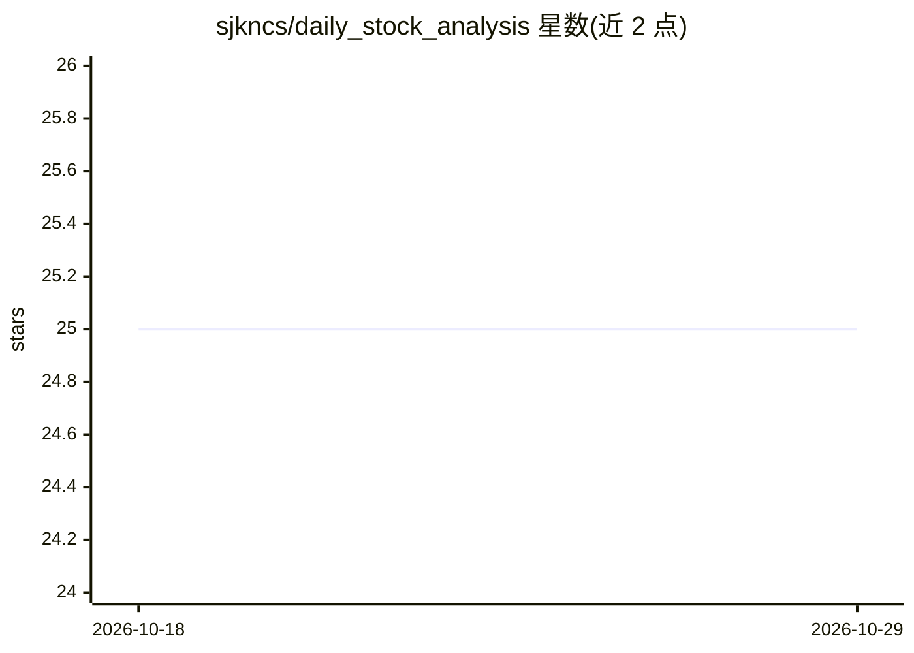

# sjkncs/daily_stock_analysis

⭐ 25 · Python · MIT · 推送 2026-02-26 · [GitHub](https://github.com/sjkncs/daily_stock_analysis) · 个人维护 · 中文 README

**AI 大模型驱动的 A股/港股/美股自选股每日分析与推送系统**

面向个人投资者的股票分析系统：每日定时对自选股运行 AI 分析，生成含核心结论、买卖点位与操作检查清单的「决策仪表盘」，并推送到企业微信/飞书/Telegram/邮件等渠道。分析覆盖技术面、筹码分布、舆情与实时行情，另提供大盘复盘、AI 回测验证（方向胜率、止盈止损命中率）。部署方式为 GitHub Actions 定时执行或本地/Docker，支持 Gemini/DeepSeek/OpenAI 兼容/Claude/Ollama 等模型，附带 React+FastAPI 的 Web 界面（技术指标、条件选股、组合风险等模块）。README 声明仅供学习研究、不构成投资建议。

## 筛选速览

| 维度 | 判定 | 备注 |
|---|---|---|
| AI 角色 | `ai-native` | 本体是模型或模型工具 |
| 许可风险 | `permissive` | MIT |
| 部署形态 | `library` | 以包/库形式分发 |
| 模型依赖 | locked-api |  |
| 硬件要求 | — | 无带数字的原话,不猜 |
| 安装摩擦 | `low` | 无编译、无系统依赖或容器化 |
| 成熟度 | — | 结构信号不足 |

## 能力要点

- 多模型支持：Gemini、OpenAI 兼容、DeepSeek、通义千问、Claude、Ollama
- 决策仪表盘：一句话结论 + 买卖点位 + 满足/注意/不满足标记的检查清单
- AI 回测验证历史分析的方向胜率与止盈止损命中率
- GitHub Actions 定时执行，无需服务器；另提供 React Web UI

## 适用场景

- 每天自动收到自选股的 AI 分析报告推送到微信/飞书/Telegram
- 查看技术指标、舆情评分与条件选股等投研工具
- 用回测功能核验历史 AI 分析的准确率

## 场景标签

`金融量化` · 领域:学习与行业

## 证据(README 行号)

> L10: > 🤖 基于 AI 大模型的 A股/港股/美股自选股智能分析系统，每日自动分析并推送「决策仪表盘」到企业微信/飞书/Telegram/邮箱
> L26: |AI|决策仪表盘|一句话核心结论 + 精确买卖点位 + 操作检查清单|
> L38: |AI 模型|Gemini（免费）、OpenAI 兼容、DeepSeek、通义千问、Claude、Ollama|

## 星数曲线

2026-10-18 25 → 2026-10-29 25（+0）

---
*卡片 v1 · prompt 1.4 · 生成 2026-10-27 · 置信度 high · 依据 README sha `1bc1e85c5182` · [字段定义](../../DATASET.md)*
