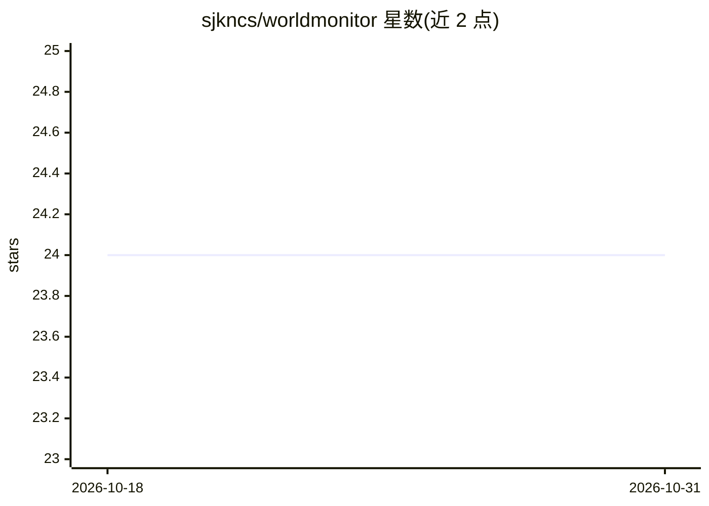

# sjkncs/worldmonitor

⭐ 24 · TypeScript · NOASSERTION · 推送 2026-03-06 · [GitHub](https://github.com/sjkncs/worldmonitor) · 个人维护 · 中文 README

**实时全球情报仪表盘：新闻聚合、地缘监控与 AI 简报**

基于 TypeScript 的实时全球情报仪表盘，聚合 100+ 新闻源与 35+ 数据图层（冲突、军事基地、海底电缆、数据中心、港口等），以 deck.gl 3D 地球呈现，并计算 54 国不稳定指数（CII）及与 34 只 ETF 的相关性。AI 部分为 LLM 合成的全球简报与国别分析，采用 Ollama→Groq→OpenRouter→浏览器端 T5 四级回退链，支持本地 Ollama/LM Studio 无 API key 运行。提供 Tauri 桌面应用（Win/macOS/Linux）与可安装 PWA，另有科技、金融两个变体。AGPL v3 许可。

## 筛选速览

| 维度 | 判定 | 备注 |
|---|---|---|
| AI 角色 | `ai-enhanced` | 去掉 AI 部分产品仍成立 |
| 许可风险 | `none` | NOASSERTION |
| 部署形态 | `desktop` | 安装包/桌面程序 |
| 模型依赖 | local-ok | 支持本地模型 |
| 硬件要求 | — | 无带数字的原话,不猜 |
| 安装摩擦 | `low` | 无编译、无系统依赖或容器化 |
| 成熟度 | — | 结构信号不足 |

## 能力要点

- LLM 简报四级回退链：Ollama→Groq→OpenRouter→浏览器端 T5
- 54 国不稳定指数（CII）与自适应权重及市场交叉验证
- 35+ 可切换数据图层与 WebGL 3D 地球（deck.gl + MapLibre）
- 16 语言界面与本地化新闻源，Tauri 桌面应用三平台发布

## 适用场景

- 在一个界面里追踪全球新闻、冲突与基础设施动态
- 离线/本地用 Ollama 生成全球情报简报，不外传数据
- 查看国家稳定性评分与市场信号的相关性分析

## 场景标签

`金融量化` `网页抓取` · 领域:效率与自动化

## 证据(README 行号)

> L12: **Real-time global intelligence dashboard** — AI-powered news aggregation, geopolitical monitoring, and infrastruct
> L159: - **World Brief** — LLM-synthesized summary of top global developments with a 4-tier provider fallback chain: Olla

## 星数曲线

2026-10-18 24 → 2026-10-31 24（+0）

---
*卡片 v1 · prompt 1.4 · 生成 2026-10-27 · 置信度 high · 依据 README sha `df9f49f2b851` · [字段定义](../../DATASET.md)*
