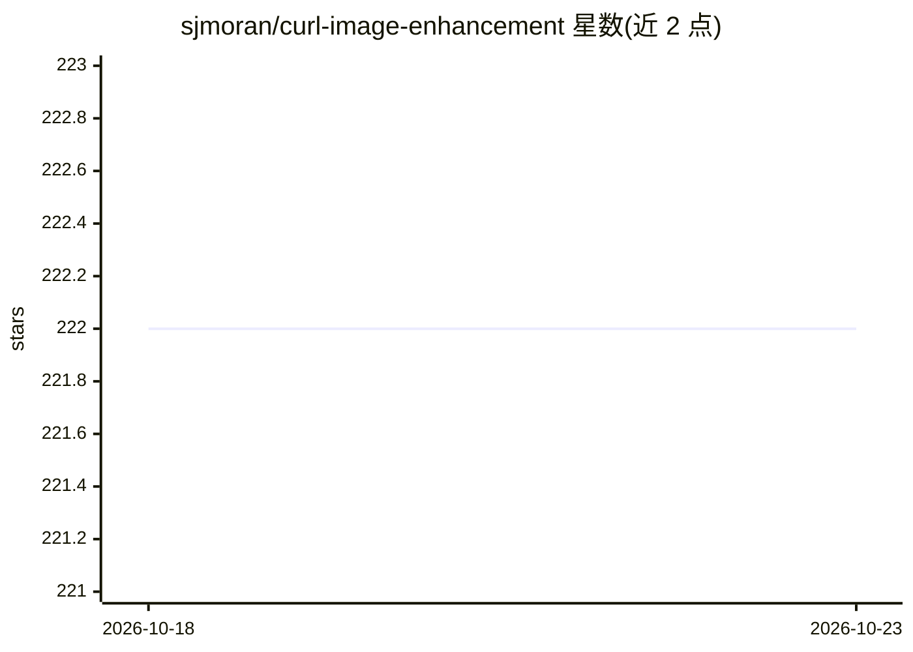

# sjmoran/curl-image-enhancement

⭐ 222 · Python · 推送 2026-09-18 · [GitHub](https://github.com/sjmoran/curl-image-enhancement) · 个人维护 · 中文 README

**ICPR 2020 论文代码：预测色调曲线实现全局图像增强**

Huawei Noah's Ark Lab 发表的 ICPR 2020 论文 CURL 的官方代码。方法：TED 编码器-解码器骨干提取逐像素特征，CURL 模块按序在 CIELab、RGB、HSV 三个色彩空间预测分段线性色调曲线（共 160 个参数）并残差混合，实现全局、分辨率无关的图像增强。以 Python 包提供，含 curl-enhance CLI、预训练 Adobe-DPE 检查点、训练/推理/消复现脚本与 51 个 CPU 测试。支持 CUDA/MPS/CPU 自选设备。

## 筛选速览

| 维度 | 判定 | 备注 |
|---|---|---|
| AI 角色 | `ai-native` | 本体是模型或模型工具 |
| 许可风险 | `none` | — |
| 部署形态 | `library` | 以包/库形式分发 |
| 模型依赖 | — | README 未给出锁定关系 |
| 硬件要求 | — | 无带数字的原话,不猜 |
| 安装摩擦 | `medium` | 含编译或系统依赖之一 |
| 成熟度 | — | 结构信号不足 |

## 能力要点

- 三色彩空间级联的神经曲线层预测（160 个参数描述整次增强）
- 提供 curl-enhance 命令行与预训练 Adobe-DPE 检查点
- 支持自训练、色彩空间消融复现与曲线记录/绘图
- 默认模型 1.7M 参数，任意分辨率输入（边长 ≥48px）

## 适用场景

- 用预训练模型批量增强照片（PNG/JPEG/TIFF/BMP/WebP）
- 复现论文的训练、推理与色彩空间消融实验
- 在 Adobe-DPE/UPE、Samsung S7 数据集上评测增强效果

## 场景标签

`图像视频处理` · 领域:感知与多模态

## 证据(README 行号)

> L22: Enhancement networks usually learn a mapping straight to output pixels. CURL
> L35: A **TED** backbone (Transformed Encoder-Decoder) reads the image and produces

## 星数曲线

2026-10-18 222 → 2026-10-23 222（+0）

---
*卡片 v1 · prompt 1.4 · 生成 2026-10-22 · 置信度 high · 依据 README sha `74e09108d22f` · [字段定义](../../DATASET.md)*
