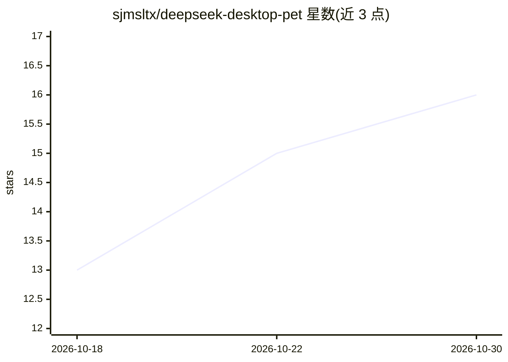

# sjmsltx/deepseek-desktop-pet

⭐ 16 · Python · MIT · 推送 2026-10-29 · [GitHub](https://github.com/sjmsltx/deepseek-desktop-pet) · 个人维护 · 中文 README

**Windows 桌面 AI 桌宠：聊天、长期记忆、工具调用（DeepSeek）**

基于 PySide6 与 DeepSeek API 的 Windows 桌面 AI 陪伴应用，以 Q 版桌宠形态常驻桌面，支持 Flash/Pro 双角色、好感度与五阶段人设进化。技术机制包括三层记忆（事实/摘要/事件，BM25 检索+事实抽取+LLM 重排序）、工具调用（时间/天气/提醒/PowerShell/搜索/MCP）、技能包与插件系统、语音朗读与离线语音输入、图片直送多模态模型，并带 API 用量与费用统计、审计日志/限额/出网白名单治理。提供免安装便携版，需自备 DeepSeek API Key；Live2D 模式仅源码运行可用。

## 筛选速览

| 维度 | 判定 | 备注 |
|---|---|---|
| AI 角色 | `ai-native` | 本体是模型或模型工具 |
| 许可风险 | `permissive` | MIT |
| 部署形态 | `library` | 以包/库形式分发 |
| 模型依赖 | locked-api |  |
| 硬件要求 | — | 无带数字的原话,不猜 |
| 安装摩擦 | `low` | 无编译、无系统依赖或容器化 |
| 成熟度 | `idea` | |

## 能力要点

- 三层长期记忆（BM25 检索 + 事实抽取 + LLM 重排序）
- 双角色 + 好感度养成 + 主动关心（链式唤醒与定时回访）
- 工具调用含 MCP server 接入（stdio/HTTP）与可安装技能包（权限声明+审计+限额+出网白名单）
- API 用量/费用按模型统计，支持第三方中转与峰谷计价

## 适用场景

- 在桌面养一只能聊天、记得住事的 AI 陪伴角色
- 让桌宠代做报表、文档、PPT 与文件整理等日常任务
- 通过 MCP 与技能包扩展桌宠能力并控制其权限与花费

## 场景标签

`聊天机器人` · 领域:对话与助手

## 证据(README 行号)

> L14: 一只住在你电脑里的 Q 版桌宠：会陪你聊天、帮你干活、还能主动关心你。
> L18: > 基于 PySide6 + DeepSeek API 的桌面 AI 陪伴助手，支持双角色、长期记忆、工具调用、主动关心机制。
> L49: **DeepSeek Desktop Pet** is a local-first AI desktop companion for Windows, built with **PySide6 (Qt) + the DeepSee

## 星数曲线

2026-10-18 13 → 2026-10-30 16（+3）

---
*卡片 v1 · prompt 1.4 · 生成 2026-10-30 · 置信度 mid · 依据 README sha `1ee727e1813d` · [字段定义](../../DATASET.md)*
