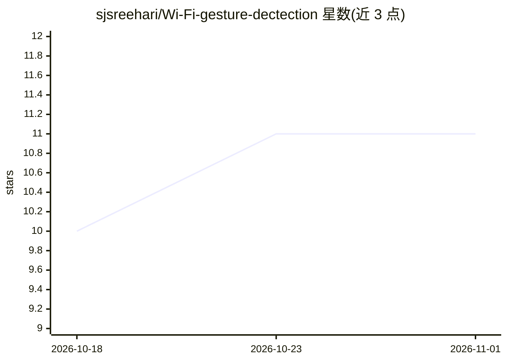

# sjsreehari/Wi-Fi-gesture-dectection

⭐ 11 · Python · MIT · 推送 2025-11-10 · [GitHub](https://github.com/sjsreehari/Wi-Fi-gesture-dectection) · 个人维护

**基于 WiFi CSI 的手势/占用检测深度学习训练系统**

利用 WiFi 信道状态信息（CSI）进行无人体接触的占用与手势状态检测：在 ESP32 硬件采集 CSI 数据，经预处理（归一化、滑窗分割）、STFT 频谱图与统计特征提取后，用 CNN2D 与 CNN1D-LSTM 双路集成模型分类三态（无人/有人静止/有人运动），报告 90.2% 测试准确率、约 2.1M 参数、CPU 推理 <50ms。仅提供训练管线（实时推理组件已移除），支持导出 ONNX，数据格式为 CSV 幅度向量。

## 筛选速览

| 维度 | 判定 | 备注 |
|---|---|---|
| AI 角色 | `ai-native` | 本体是模型或模型工具 |
| 许可风险 | `permissive` | MIT |
| 部署形态 | `None` |  |
| 模型依赖 | — | README 未给出锁定关系 |
| 硬件要求 | — | 无带数字的原话,不猜 |
| 安装摩擦 | `medium` | 含编译或系统依赖之一 |
| 成熟度 | — | 结构信号不足 |

## 能力要点

- CNN2D + CNN1D-LSTM 双路加权集成（α=0.6/0.4），三分类 90.2% 准确率
- STFT 频谱图 + 每子载波 8 种统计特征的特征提取管线
- ESP32 商用 WiFi 硬件采集 CSI，无需摄像头或穿戴设备
- 支持 ONNX 导出与 CUDA 加速（可选）

## 适用场景

- 用现有 WiFi 设备做无接触的房间占用/运动状态检测
- 复现或扩展基于 CSI 的深度学习感知实验
- 对采集的 CSI 数据集做批处理训练与评估

## 场景标签

`模型训练` · 领域:训练与推理

## 证据(README 行号)

> L25: WiFi CSI Gesture Detection is an innovative **deep learning-based system** that leverages WiFi Channel State Inform
> L31: - **Ensemble Architecture**: Dual-path fusion of CNN2D (spectrogram) and CNN1D-LSTM (temporal) models
> L169: - System designed for training pipeline only (real-time inference components removed)

## 星数曲线

2026-10-18 10 → 2026-11-01 11（+1）

---
*卡片 v1 · prompt 1.4 · 生成 2026-11-01 · 置信度 high · 依据 README sha `7a456eb86cfe` · [字段定义](../../DATASET.md)*
