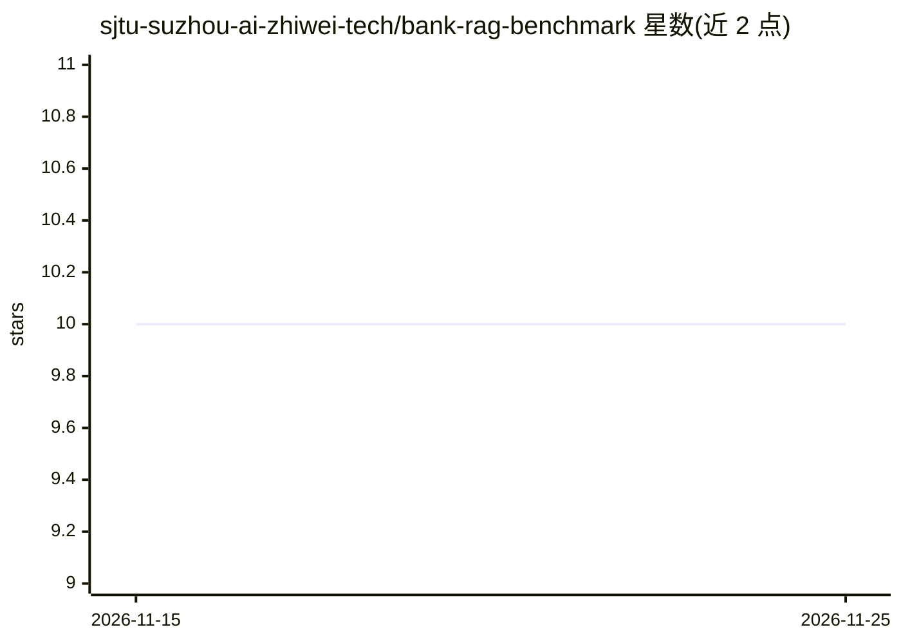

# sjtu-suzhou-ai-zhiwei-tech/bank-rag-benchmark

⭐ 10 · CC-BY-4.0 · 推送 2026-08-11 · [GitHub](https://github.com/sjtu-suzhou-ai-zhiwei-tech/bank-rag-benchmark) · 组织维护 · 中文 README

**面向中文银行知识库 RAG 系统的评测基准数据集**

由上海交通大学苏州人工智能研究院与上交致微联合发布的中文银行领域 RAG 评测基准，包含 100 份 PDF 文档（265 页）与 450 条测试案例。测试问题按基础事实、多跳检索、相似文档区分、版本更新、逻辑推理与边界五类组织，分简单/中等/困难三档；每条案例含测试问题、预期答案与应命中文档，供使用者导入文档到被测系统后逐条调用并自行统计召回率、正确率等指标。基准不限定模型、向量库与评测工具，仓库仅提供数据，不含评测脚本。

## 筛选速览

| 维度 | 判定 | 备注 |
|---|---|---|
| AI 角色 | `ai-knowledge` | 知识聚合/清单类 |
| 许可风险 | `viral` | CC-BY-4.0 |
| 部署形态 | `None` |  |
| 模型依赖 | — | README 未给出锁定关系 |
| 硬件要求 | — | 无带数字的原话,不猜 |
| 安装摩擦 | `low` | 无编译、无系统依赖或容器化 |
| 成熟度 | — | 结构信号不足 |

## 能力要点

- 100 份 PDF 文档 + 450 条测试案例的五类问题分布
- 每条案例提供预期答案与应命中文档用于人工核验
- 不限定模型、向量数据库、切片策略与评分工具
- 数据完整性声明：编号唯一、文档引用双向覆盖

## 适用场景

- 导入银行 PDF 知识库后评测 RAG 系统的检索与回答质量
- 按文档命中率与答案正确率比较不同检索配置
- 教学中演示知识库问答系统的能力边界

## 场景标签

`模型评测` `RAG` · 领域:评测与运维

## 证据(README 行号)

> L3: 一套面向中文银行知识库 RAG（Retrieval-Augmented Generation，检索增强生成）系统的评测基准，包含 100 份 PDF 文档和 450 条测试案例。
> L5: 本基准用于验证知识库系统在基础事实、多跳检索、相似文档区分、版本更新识别，以及逻辑推理与边界判断等场景下的表现。
> L68: 本仓库不限定模型、向量数据库、切片策略、向量模型、重排模型或评分工具。GitHub 网页不能可靠预览全部 `.xlsx` 内容，建议下载到本地后查看。

## 星数曲线

2026-11-15 10 → 2026-11-25 10（+0）

---
*卡片 v1 · prompt 1.4 · 生成 2026-11-19 · 置信度 high · 依据 README sha `1ad574239fb0` · [字段定义](../../DATASET.md)*
