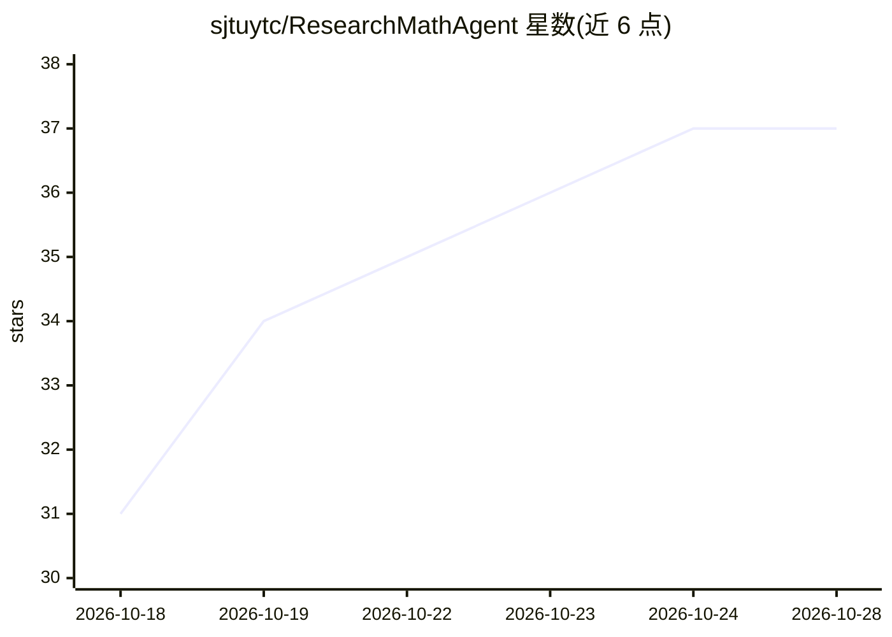

# sjtuytc/ResearchMathAgent

⭐ 37 · Python · 推送 2026-09-17 · [GitHub](https://github.com/sjtuytc/ResearchMathAgent) · 组织维护 · 中文 README

**面向研究级数学难题的多智能体证明框架（论文官方代码）**

COLM 2026 Workshop 论文 RMA 的官方代码发布：以 Initializer/Proposer/Verifier/Refiner 多智能体流水线加共享结构化记忆，对研究级数学问题（非竞赛题、非形式化定理证明）做文献检索、知识库构建与迭代证明生成与验证。内置 7 个数据集共 22,000+ 题目；LLM 后端支持 Anthropic Messages API 或 Claude Code CLI（Pro/Max 订阅计费）。提供 rma CLI、FastAPI Web UI（流式求解、PDF 预览、issue 追踪）与夜间自动运行 worker；基准污染边界在代码中强制执行。

## 筛选速览

| 维度 | 判定 | 备注 |
|---|---|---|
| AI 角色 | `ai-native` | 本体是模型或模型工具 |
| 许可风险 | `none` | — |
| 部署形态 | `library` | 以包/库形式分发 |
| 模型依赖 | locked-api |  |
| 硬件要求 | — | 无带数字的原话,不猜 |
| 安装摩擦 | `low` | 无编译、无系统依赖或容器化 |
| 成熟度 | — | 结构信号不足 |

## 能力要点

- Initializer→Proposer→Verifier→Refiner 多智能体流水线与共享结构化记忆
- 内置 7 个研究级数据集共 22,000+ 问题（First Proof、Erdős、ResearchMath-14k 等）
- 双 Claude 后端：Anthropic API 或 Claude Code 订阅 CLI
- Web UI 提供流式步骤查看、PDF 编译预览与 GitHub Issues 协作 API

## 适用场景

- 在自有 Claude 订阅上自动求解研究级数学问题
- 在 First Proof 等基准上运行多智能体证明实验
- 夜间无人值守跑求解器并生成带日期的研究报告

## 场景标签

`多智能体` `科研工具` · 领域:Agent 开发

## 证据(README 行号)

> L19: > RMA is the first agentic framework that targets **research-level mathematical proof** — not competition problems,
> L24: |**Multi-agent pipeline**|Initializer → Proposer → Verifier → Refiner, coordinated through shared structured memory
> L51: We present **Research Math Agents (RMA)**, an agentic framework for automated reasoning on research-level mathemati

## 星数曲线

2026-10-18 31 → 2026-10-28 37（+6）

---
*卡片 v1 · prompt 1.4 · 生成 2026-10-25 · 置信度 high · 依据 README sha `93447e6d6082` · [字段定义](../../DATASET.md)*
