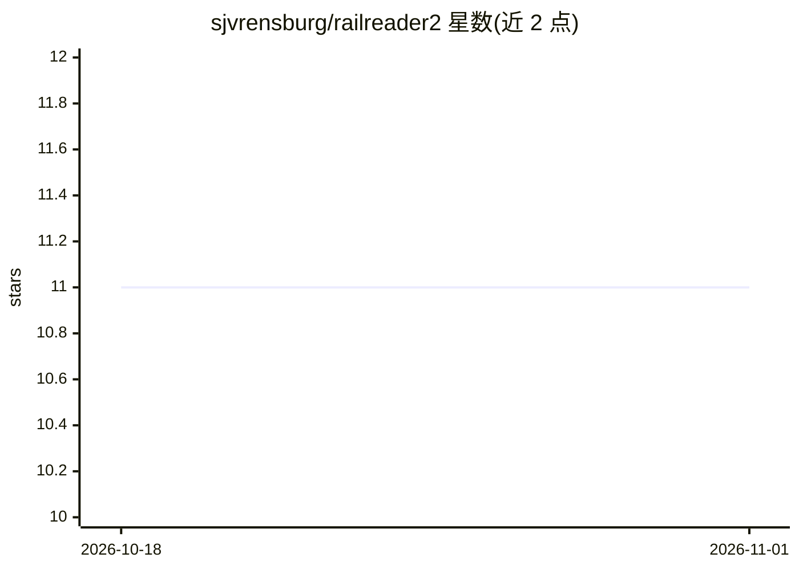

# sjvrensburg/railreader2

⭐ 11 · C# · MIT · 推送 2026-10-31 · [GitHub](https://github.com/sjvrensburg/railreader2) · [官网](https://sjvrensburg.github.io/railreader2/) · 个人维护

**为高倍放大阅读优化的桌面 PDF 阅读器**

基于 Avalonia/.NET 的桌面 PDF 阅读器，面向需要在高倍缩放下阅读的用户（如视障或低视力读者、学术论文读者）。核心机制是内置的 AI 版面检测模型（默认 Docling Heron，可选 PP-DocLayoutV3）识别段落、标题、公式、表格与阅读顺序，缩放超过约 300% 后进入"轨道阅读"模式，逐行引导视口移动。全部处理在本地运行，模型随安装包分发。提供 Windows（Microsoft Store/安装包）与 Linux（AppImage/tar.gz）版本，附 CLI 工具可将 PDF 转为 Markdown。可选启用 GPU 加速与 OpenAI 兼容视觉模型的公式/表格复制功能。

## 筛选速览

| 维度 | 判定 | 备注 |
|---|---|---|
| AI 角色 | `ai-enhanced` | 去掉 AI 部分产品仍成立 |
| 许可风险 | `permissive` | MIT |
| 部署形态 | `desktop` | 安装包/桌面程序 |
| 模型依赖 | local-ok | 支持本地模型 |
| 硬件要求 | — | 无带数字的原话,不猜 |
| 安装摩擦 | `medium` | 含编译或系统依赖之一 |
| 成熟度 | — | 结构信号不足 |

## 能力要点

- 内置本地运行的 AI 版面检测模型，自动确定阅读顺序
- 轨道阅读模式：逐行导航、半自动滚动、行聚焦/高亮、颜色滤镜
- OCR 支持扫描文档，附命令行工具导出 Markdown/JSON
- 标注、书签、 portals、冻结窗格等阅读辅助功能，配置文件可手动编辑

## 适用场景

- 高倍放大下逐行阅读学术论文而不迷失位置
- 低视力用户借助行高亮、颜色滤镜与自动滚动阅读 PDF
- 将扫描版 PDF 做 OCR 后进行轨道阅读与搜索
- 批量把 PDF（含公式、表格、标注）导出为结构化 Markdown

## 场景标签

 · 领域:桌面阅读工具/无障碍

## 证据(README 行号)

> L5:  A PDF reader built for comfortable reading at high magnification.
> L26: When you open a page, an AI layout model works out where the paragraphs, headings, equations, tables and figures ar
> L33: Everything runs on your own computer. The layout model is included in the download, and nothing is sent anywhere un

## 星数曲线

2026-10-18 11 → 2026-11-01 11（+0）

---
*卡片 v1 · prompt 1.4 · 生成 2026-11-01 · 置信度 high · 依据 README sha `def9195b988e` · [字段定义](../../DATASET.md)*
