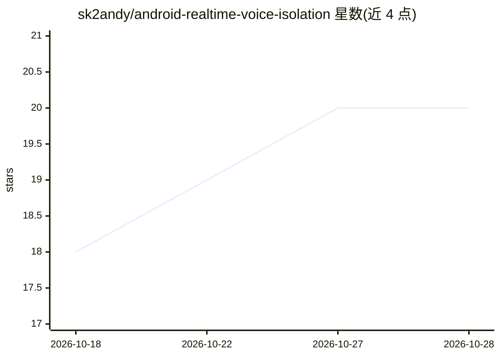

# sk2andy/android-realtime-voice-isolation

⭐ 20 · Kotlin · MIT · 推送 2026-10-08 · [GitHub](https://github.com/sk2andy/android-realtime-voice-isolation) · 个人维护 · 中文 README

**安卓端设备上实时人声隔离应用：GTCRN+ONNX Runtime 处理媒体音频**

面向 Android 13+ 用户的应用，通过 Shizuku 建立 AudioPolicy 回环路由捕获媒体与游戏音频，用设备端流式 GTCRN 模型（ONNX Runtime 推理）做人声增强与背景衰减，可分别调节背景抑制（0-100%）与人声增益（最高约 +6 dB）。处理全程离线，应用不含网络权限。提供快捷开关磁贴、常驻通知、预设持久化、Auto 模式及 token 保护的 Tasker/ADB 自动化 API。限制：GTCRN 做语音增强而非完美人声分离；无 root 时 Shizuku 需每次重启后手动启动；部分 DRM/硬件卸载播放与厂商 ROM 不受支持。

## 筛选速览

| 维度 | 判定 | 备注 |
|---|---|---|
| AI 角色 | `ai-native` | 本体是模型或模型工具 |
| 许可风险 | `permissive` | MIT |
| 部署形态 | `library` | 以包/库形式分发 |
| 模型依赖 | — | README 未给出锁定关系 |
| 硬件要求 | — | 无带数字的原话,不猜 |
| 安装摩擦 | `low` | 无编译、无系统依赖或容器化 |
| 成熟度 | — | 结构信号不足 |

## 能力要点

- Shizuku AudioPolicy 回环路由捕获媒体/游戏音频并在设备端流式处理
- 背景抑制与人声增益独立调节，含 Auto 模式与持久化预设
- 处理完全离线，应用不申请网络权限
- token 保护的自动化 API 支持 Tasker/ADB 控制启停、预设与强度

## 适用场景

- 在手机上看视频/玩游戏时实时压低背景声、突出人声
- 通过快捷设置磁贴或 Tasker 一键启停音频隔离
- 为播客、影视、游戏场景切换不同隔离预设

## 场景标签

 · 领域:音频/语音增强

## 证据(README 行号)

> L3: Android app that captures regular media and game audio through Shizuku and processes it with an on-device streaming 
> L17: - Processing stays entirely on-device; the app intentionally has no internet permission.
> L70: |Model quality|GTCRN performs speech enhancement, not perfect vocal separation; music is usually attenuated strongl

## 星数曲线

2026-10-18 18 → 2026-10-28 20（+2）

---
*卡片 v1 · prompt 1.4 · 生成 2026-10-28 · 置信度 mid · 依据 README sha `d790280334d7` · [字段定义](../../DATASET.md)*
