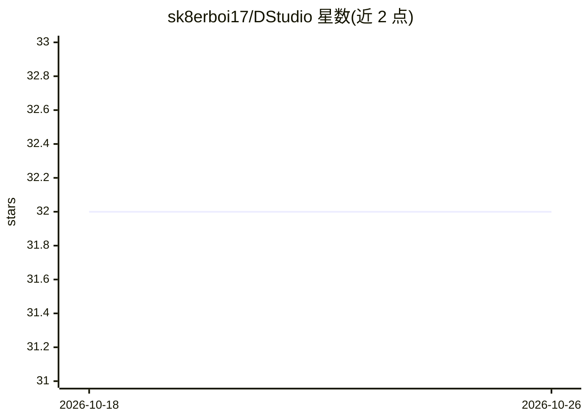

# sk8erboi17/DStudio

⭐ 32 · TypeScript · BSD-3-Clause · 推送 2026-10-25 · [GitHub](https://github.com/sk8erboi17/DStudio) · 个人维护

**本地优先桌面 AI 工作台：聊天、编码 Agent 与设计一体**

macOS（Apple Silicon）本地优先的开源桌面应用，集成 DeepSeek V4、GLM 5.3 Flash、Laguna S 2.1、Qwen3.6/3.8 与 MiniMax H3 等模型，提供 Chat、Agent、Cowork 与 Design 四种模式，含文档研究、OCR、图像与视频生成。内置三种推理引擎（ds4、llama.cpp、MLX），Agent 模式可切换 pi 或 OpenCode 作为 harness，云账户与远程 API 端点均为可选。限制：README 自称非合格发布的进行中源码树，最新发布 1.1.0 未含新引擎改动；Linux/Windows 已编译未运行，多个资格测试项未完成。

## 筛选速览

| 维度 | 判定 | 备注 |
|---|---|---|
| AI 角色 | `ai-native` | 本体是模型或模型工具 |
| 许可风险 | `permissive` | BSD-3-Clause |
| 部署形态 | `desktop` | 安装包/桌面程序 |
| 模型依赖 | local-ok | 支持本地模型 |
| 硬件要求 | — | 无带数字的原话,不猜 |
| 安装摩擦 | `high` | 编译与系统依赖俱全 |
| 成熟度 | `idea` | |

## 能力要点

- 三种内置推理引擎（ds4、llama.cpp、MLX）覆盖全部模式
- Agent 模式可切换 pi 或 OpenCode harness，共享模型与工作区
- 本地 OCR（Apple Vision）、图像/视频媒体 worker、LAN 远程 Cowork 会话
- DStudio 自管 llama-server 与 MLX 服务器生命周期（含崩溃守护进程）

## 适用场景

- 在 Mac 上离线使用本地大模型进行聊天、编码与知识工作
- 通过远程 API 端点替代本地推理而保留本地工具链
- 从手机/平板加入局域网配对的 Cowork 会话

## 场景标签

`编码 Agent` `聊天机器人` `图像生成` `视频生成` · 领域:编码与开发

## 证据(README 行号)

> L5: **An open-source, local-first workspace for DeepSeek V4, GLM 5.3 Flash, Laguna S 2.1 and Qwen: private chat, coding 
> L161: |Model|Engine|Modes|Size and important limits|
> L175: Separate media workers provide **Ideogram 4** image generation,

## 星数曲线

2026-10-18 32 → 2026-10-26 32（+0）

---
*卡片 v1 · prompt 1.4 · 生成 2026-10-25 · 置信度 mid · 依据 README sha `79baa0f1ec4c` · [字段定义](../../DATASET.md)*
