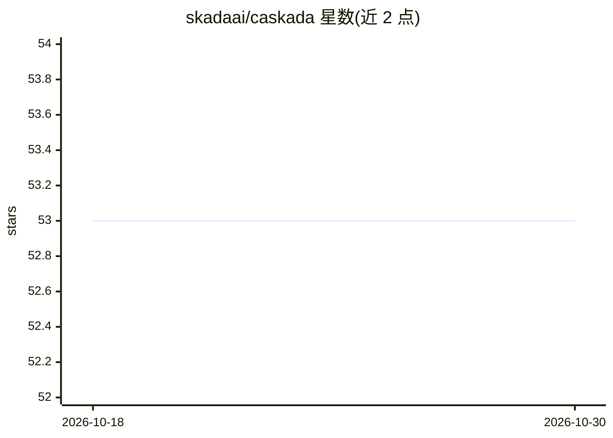

# skadaai/caskada

⭐ 53 · Python · MPL-2.0 · 推送 2026-08-16 · [GitHub](https://github.com/skadaai/caskada) · [官网](https://skada.ai/caskada) · 组织维护

**极简 AI agent 开发框架：300 行实现图式编排**

从 PocketFlow 分叉而来的极简 LLM 应用框架，以嵌套有向图为核心抽象：Node 承担带 prep→exec→post 生命周期的任务，Flow 通过带标签的边编排执行，Memory 管理全局与局部共享状态。零依赖、无厂商锁定，支持 Python 与 TypeScript 双语言，可在此之上实现 Agent、Workflow、RAG、Map-Reduce、Multi-Agent 等模式。面向希望由人和 AI 助手协作编写 AI 系统的开发者，提供分难度教程。

## 筛选速览

| 维度 | 判定 | 备注 |
|---|---|---|
| AI 角色 | `ai-ecosystem` | LLM/agent 周边工具 |
| 许可风险 | `permissive` | MPL-2.0 |
| 部署形态 | `library` | 以包/库形式分发 |
| 模型依赖 | — | README 未给出锁定关系 |
| 硬件要求 | — | 无带数字的原话,不猜 |
| 安装摩擦 | `low` | 无编译、无系统依赖或容器化 |
| 成熟度 | — | 结构信号不足 |

## 能力要点

- 核心抽象约 300 行代码，零依赖
- Node/Flow/Memory 图式架构，支持嵌套有向图与共享状态
- Python 与 TypeScript 双语言实现
- 配套 Chat/RAG/Agent/Multi-Agent 等系列教程

## 适用场景

- 用极简依赖构建 Agent、Workflow 或 RAG 应用
- 让 AI 助手协作编写和修改 AI 系统（Agentic Coding）
- 学习 LLM 应用常见设计模式的实现

## 场景标签

`Agent 框架` `RAG` `教程课程` · 领域:Agent 开发

## 证据(README 行号)

> L25: Caskada is a framework enabling _Agentic Coding_ through powerful abstractions.
> L27: It provides a simple interface for building complex AI applications based on _nested directed graphs_ with shared s

## 星数曲线

2026-10-18 53 → 2026-10-30 53（+0）

---
*卡片 v1 · prompt 1.4 · 生成 2026-10-24 · 置信度 high · 依据 README sha `f013fec1e5f1` · [字段定义](../../DATASET.md)*
