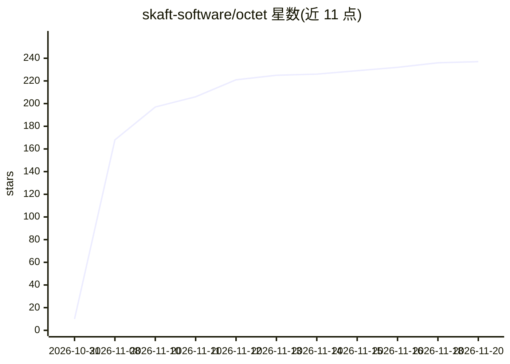

# skaft-software/octet

⭐ 237 · Rust · MIT · 推送 2026-11-19 · [GitHub](https://github.com/skaft-software/octet) · [官网](https://octet.skaft.org) · 组织维护

**Rust 编写的终端编码 agent，支持多模态输入与任意语言扩展**

原生 Rust 单进程的终端编码代理：读代码、编辑文件、跑测试、管理会话，核心无需 Node/Python 运行时。可接入云端或本地模型，会话可恢复；扩展以独立子进程形式通过 JSON-RPC 2.0 通信，提供 Python/TypeScript/Rust/C++/C 的 SDK 与若干第一方集成（MCP、子代理、computer-use、web-search）。支持音频输入与桌面操控（视模型路由而定），并附带实验性的 Pi 扩展兼容适配层。项目自述为 hobby project，Windows 为 preview。

## 筛选速览

| 维度 | 判定 | 备注 |
|---|---|---|
| AI 角色 | `ai-native` | 本体是模型或模型工具 |
| 许可风险 | `permissive` | MIT |
| 部署形态 | `library` | 以包/库形式分发 |
| 模型依赖 | — | README 未给出锁定关系 |
| 硬件要求 | — | 无带数字的原话,不猜 |
| 安装摩擦 | `medium` | 含编译或系统依赖之一 |
| 成熟度 | `idea` | |

## 能力要点

- 单进程 Rust 核心：会话、权限、终端 UI、资源限制一体，无需 Node/Python
- 扩展为独立进程，经 JSON-RPC 2.0 用任意语言编写
- 原生音频输入与 computer-use 能力（依赖模型路由）
- 签名发布、校验和与可复现的基准证据包

## 适用场景

- 在终端里让 agent 读代码、改文件、跑测试
- 用任意语言编写 JSON-RPC 扩展来扩展 agent 能力
- 在音频与桌面操控同一会话中与模型交互

## 场景标签

`编码 Agent` `多模态` · 领域:编码与开发

## 证据(README 行号)

> L17: octet reads code, edits files, runs tests and manages sessions from your terminal. One native
> L21: It runs cloud or local models, keeps resumable sessions, and takes tools as subprocess
> L23: and **drive your computer** in the same conversation, which is why it exists.

## 星数曲线

2026-10-31 10 → 2026-11-20 237（+227）

---
*卡片 v1 · prompt 1.4 · 生成 2026-11-17 · 置信度 high · 依据 README sha `fb454029cb7a` · [字段定义](../../DATASET.md)*
