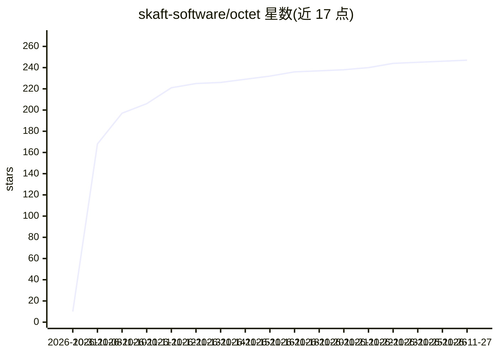

# skaft-software/octet

⭐ 247 · Rust · MIT · 推送 2026-11-26 · [GitHub](https://github.com/skaft-software/octet) · [官网](https://octet.skaft.org) · 个人维护

**终端里的 Rust 原生编码 agent，支持任意语言扩展与音频输入**

octet 是运行于终端的编码 agent：读取代码、编辑文件、运行测试并管理会话。核心为单一 Rust 原生进程，承载 agent 循环、权限、持久化、终端 UI 与资源限制，不依赖 Node/Python/Bun。可运行云端或本地模型，工具以 JSON-RPC 2.0 子进程形式接入，支持 Python、TypeScript、Rust、C++ 等任意语言编写扩展；可选安装 octet-pi-compat 适配器运行 Pi 扩展（实验性、按扩展判定兼容）。支持原生音频输入与 computer-use。安装渠道包括安装脚本、cargo、npm 启动器与源码构建。作者声明这是个人爱好项目，Windows 为预览版。

## 筛选速览

| 维度 | 判定 | 备注 |
|---|---|---|
| AI 角色 | `ai-native` | 本体是模型或模型工具 |
| 许可风险 | `permissive` | MIT |
| 部署形态 | `library` | 以包/库形式分发 |
| 模型依赖 | — | README 未给出锁定关系 |
| 硬件要求 | — | 无带数字的原话,不猜 |
| 安装摩擦 | `medium` | 含编译或系统依赖之一 |
| 成熟度 | `idea` | |

## 能力要点

- Rust 原生核心，无需 Node/Python/Bun 运行时
- 任意语言 JSON-RPC 子进程扩展机制，附 Python/TypeScript/Rust/C++/Perl 示例
- 原生音频输入与 computer-use 集成（依赖模型能力）
- 发布带签名、校验和与 Sigstore bundle，可复现构建

## 适用场景

- 在终端中让 agent 读写代码并运行测试
- 用任意语言为自己的工具链编写 agent 扩展
- 在 Rust 项目中本地构建并定制编码 agent

## 场景标签

`编码 Agent` · 领域:编码与开发

## 证据(README 行号)

> L24: octet reads code, edits files, runs tests and manages sessions from your terminal. One native
> L28: It runs cloud or local models, keeps resumable sessions, and takes tools as subprocess
> L62: **It's yours to extend.** Extensions are separate processes speaking JSON-RPC 2.0. Python,

## 星数曲线

2026-10-31 10 → 2026-11-27 247（+237）

---
*卡片 v1 · prompt 1.4 · 生成 2026-11-27 · 置信度 high · 依据 README sha `4ae774796c11` · [字段定义](../../DATASET.md)*
