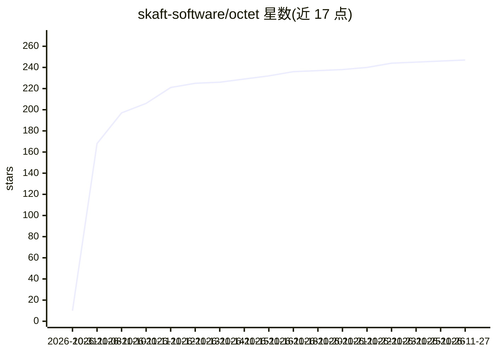

# skaft-software/octet

⭐ 247 · Rust · MIT · 推送 2026-11-26 · [GitHub](https://github.com/skaft-software/octet) · [官网](https://octet.skaft.org) · 个人维护

**终端里的 Rust 原生编码 agent，支持任意语言扩展**

单进程 Rust 终端编码工具：读取代码、编辑文件、运行测试、管理会话，核心不依赖 Node/Python/Bun。工具以 JSON-RPC 2.0 子进程形式扩展，可用 Python/TypeScript/Rust/C++ 或无 SDK 实现；支持音频输入与 computer-use 类操作。云模型或本地模型均可接入，会话可恢复。Pi 扩展经由可选实验性适配器 octet-pi-compat 运行，需 Node 22.19+，兼容性按扩展逐个记录。面向在终端工作的开发者。

## 筛选速览

| 维度 | 判定 | 备注 |
|---|---|---|
| AI 角色 | `ai-native` | 本体是模型或模型工具 |
| 许可风险 | `permissive` | MIT |
| 部署形态 | `library` | 以包/库形式分发 |
| 模型依赖 | — | README 未给出锁定关系 |
| 硬件要求 | — | 无带数字的原话,不猜 |
| 安装摩擦 | `medium` | 含编译或系统依赖之一 |
| 成熟度 | — | 结构信号不足 |

## 能力要点

- 单原生 Rust 进程承载 agent 循环、会话、权限与终端 UI
- 扩展为 JSON-RPC 2.0 子进程，任意语言可写，附 Python/TypeScript/Rust/C++/Perl 示例
- 原生音频输入，模型可在同一上下文处理 WAV 并调用工具
- CI 签名发布，附校验和与 Sigstore bundle

## 适用场景

- 在终端里让 agent 读取代码、编辑文件并跑测试
- 用任意语言编写自己的 agent 工具扩展
- 通过适配器运行已有 Pi 扩展并反馈兼容结果

## 场景标签

`编码 Agent` `GUI 自动化` · 领域:效率与自动化

## 证据(README 行号)

> L5:  A fast, native coding agent for your terminal.
> L23: octet reads code, edits files, runs tests and manages sessions from your terminal. One native
> L27: It runs cloud or local models, keeps resumable sessions, and takes tools as subprocess

## 星数曲线

2026-10-31 10 → 2026-11-27 247（+237）

---
*卡片 v1 · prompt 1.4 · 生成 2026-11-25 · 置信度 high · 依据 README sha `34d9fbbf013a` · [字段定义](../../DATASET.md)*
