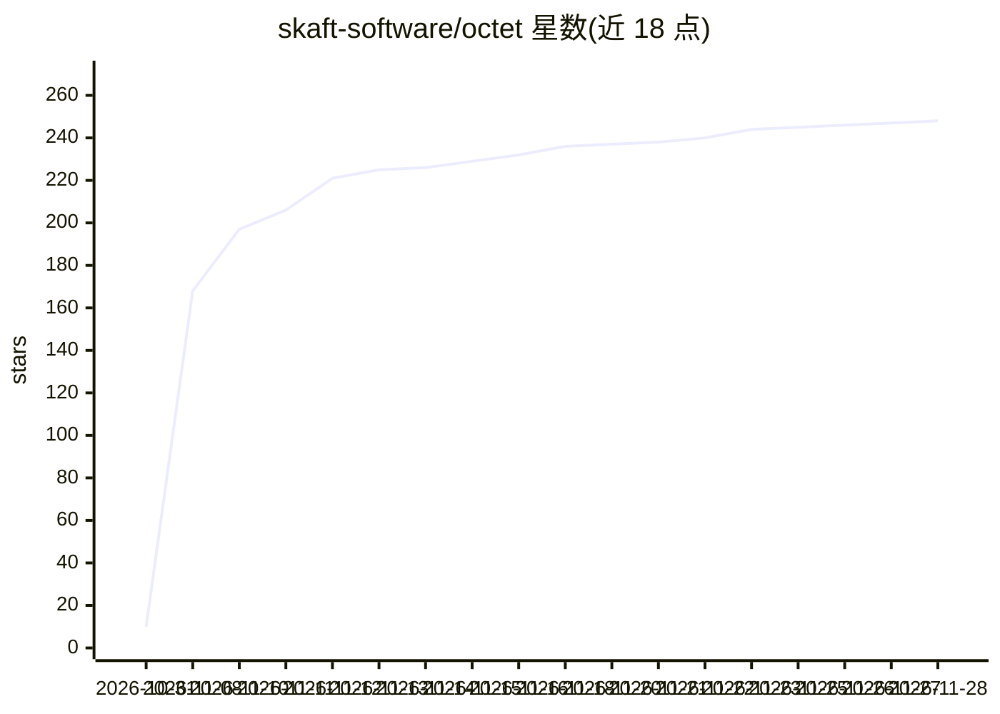

# skaft-software/octet

⭐ 248 · Rust · MIT · 推送 2026-11-27 · [GitHub](https://github.com/skaft-software/octet) · [官网](https://octet.skaft.org) · 个人维护

**终端里的 Rust 原生 coding agent，支持任意语言扩展**

octet 是一个在终端运行的编码 agent：读取代码、编辑文件、运行测试并管理会话。核心为单个原生 Rust 进程，包含 agent 循环、权限、持久化、终端 UI 与资源限制，运行时不依赖 Node/Python/Bun。模型可走云端或本地；工具以子进程形式作为 JSON-RPC 2.0 扩展接入，可用任意语言编写，官方提供 Python/TypeScript/Rust/C++ SDK。支持音频输入与 computer-use 类集成（捆绑包可选安装），并提供可复现的签名发布与校验和。Windows 为 preview，Pi 扩展兼容按逐个扩展计。

## 筛选速览

| 维度 | 判定 | 备注 |
|---|---|---|
| AI 角色 | `ai-native` | 本体是模型或模型工具 |
| 许可风险 | `permissive` | MIT |
| 部署形态 | `library` | 以包/库形式分发 |
| 模型依赖 | — | README 未给出锁定关系 |
| 硬件要求 | — | 无带数字的原话,不猜 |
| 安装摩擦 | `medium` | 含编译或系统依赖之一 |
| 成熟度 | — | 结构信号不足 |

## 能力要点

- 原生 Rust 核心，agent 循环/会话/权限/TUI 单进程承载，无需 Node/Python/Bun
- 扩展为独立 JSON-RPC 2.0 进程，任意语言可写，含 Python/TS/Rust/C++ SDK
- 原生音频输入，模型可在同一上下文中听音频并调用工具
- CI 签名发布，附带校验和、Sigstore 与基准复现证据包

## 适用场景

- 在终端里让 agent 读写代码并运行测试
- 用任意语言编写 JSON-RPC 扩展扩展 agent 能力
- 在 CI 中以固定版本的脚本化安装部署编码 agent
- 在无转写往返的情况下让模型直接处理音频输入

## 场景标签

`编码 Agent` · 领域:编码与开发

## 证据(README 行号)

> L5:  A fast, native coding agent for your terminal.
> L23: octet reads code, edits files, runs tests and manages sessions from your terminal. One native
> L27: It runs cloud or local models, keeps resumable sessions, and takes tools as subprocess

## 星数曲线

2026-10-31 10 → 2026-11-28 248（+238）

---
*卡片 v1 · prompt 1.4 · 生成 2026-11-28 · 置信度 high · 依据 README sha `48dcee04c43a` · [字段定义](../../DATASET.md)*
