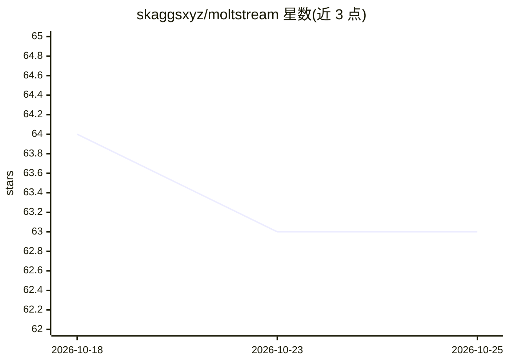

# skaggsxyz/moltstream

⭐ 63 · TypeScript · MIT · 推送 2026-04-09 · [GitHub](https://github.com/skaggsxyz/moltstream) · [官网](https://moltstream.app) · 个人维护

**在 Kick 上部署自主 AI 虚拟主播的流媒体运行时**

TypeScript monorepo（Turborepo 管理）形式的 agent-native 流媒体运行时：通过 Kick WebSocket 读取直播聊天，将消息送入 LLM（默认 Gemini 2.5 Flash，可选 Anthropic Claude）生成回复，经 Fish Audio/ElevenLabs/OpenAI TTS 合成语音，驱动带口型同步的浏览器虚拟形象页面，再由 OBS 以 RTMPS 推流到 Kick。提供 MCP server 供 Claude Desktop、Cursor 等客户端控制启停、换人格、查推理轨迹。一条 npx 命令即可启动，需 Node.js 20+、OBS 28+ 及各 API key。

## 筛选速览

| 维度 | 判定 | 备注 |
|---|---|---|
| AI 角色 | `ai-ecosystem` | LLM/agent 周边工具 |
| 许可风险 | `permissive` | MIT |
| 部署形态 | `library` | 以包/库形式分发 |
| 模型依赖 | — | README 未给出锁定关系 |
| 硬件要求 | — | 无带数字的原话,不猜 |
| 安装摩擦 | `medium` | 含编译或系统依赖之一 |
| 成熟度 | — | 结构信号不足 |

## 能力要点

- 聊天→LLM→TTS→口型同步虚拟形象→OBS 推流的完整直播管线
- MCP server 提供 9 个控制工具（启停、人格热切换、推理轨迹查询等）
- npx moltstream 一条命令启动，自动经 OBS WebSocket 配置推流
- 14 个子包：策略过滤、审计日志、Docker 隔离运行时、场景图引擎等

## 适用场景

- 在 Kick 频道部署一个读聊天并实时语音回复的 AI 主播
- 通过 Claude/Cursor 等 MCP 客户端远程控制直播与查看 agent 思考轨迹
- 作为 agent 直播的基础设施做二次开发与扩展平台适配

## 场景标签

`Agent 框架` · 领域:Agent 开发

## 证据(README 行号)

> L19: MoltStream is an agent-native streaming runtime. It turns an LLM into a live broadcaster — reading chat, generating
> L126: |`@moltstream/core`|Agent runtime, state management, memory, event bus|

## 星数曲线

2026-10-18 64 → 2026-10-25 63（-1）

---
*卡片 v1 · prompt 1.4 · 生成 2026-10-24 · 置信度 high · 依据 README sha `77ad3522659b` · [字段定义](../../DATASET.md)*
