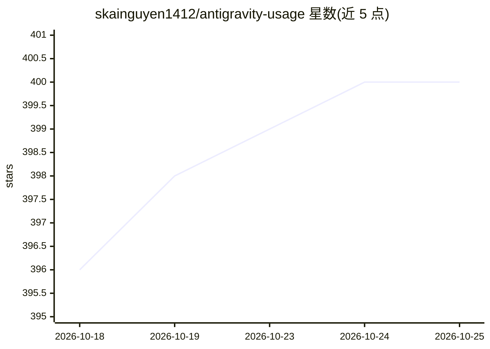

# skainguyen1412/antigravity-usage

⭐ 401 · TypeScript · MIT · 推送 2026-02-24 · [GitHub](https://github.com/skainguyen1412/antigravity-usage) · 个人维护

**追踪 Antigravity 模型配额与用量的 CLI 工具**

面向 Antigravity IDE 用户（VSCode、JetBrains 等）的 Node.js 命令行工具，读取本地 IDE 内运行的 Antigravity Language Server 获取配额数据，失败时回退到 Google Cloud Code API（需一次性 Google 登录）。支持多账号管理并排对比、5 分钟缓存、隐藏补全类模型、以及通过系统 cron 定时唤醒 Claude/Gemini 模型以消耗每日配额（macOS/Linux，Windows 未支持）。npm 全局安装即可使用。

## 筛选速览

| 维度 | 判定 | 备注 |
|---|---|---|
| AI 角色 | `ai-ecosystem` | LLM/agent 周边工具 |
| 许可风险 | `permissive` | MIT |
| 部署形态 | `library` | 以包/库形式分发 |
| 模型依赖 | — | README 未给出锁定关系 |
| 硬件要求 | — | 无带数字的原话,不猜 |
| 安装摩擦 | `low` | 无编译、无系统依赖或容器化 |
| 成熟度 | — | 结构信号不足 |

## 能力要点

- 双通道取数：本地 IDE 服务器优先，Google Cloud Code API 回退
- 多 Google 账号管理与配额并排对比
- wakeup 定时任务（cron 集成、配额重置检测、冷却保护）
- 令牌仅存本地，5 分钟智能缓存

## 适用场景

- 在终端快速查看 Antigravity 剩余额度与重置时间
- 管理多个 Google 账号并比较各自配额
- 定时唤醒模型避免配额过期浪费

## 场景标签

 · 领域:AI 开发者工具/用量监控

## 证据(README 行号)

> L10: A fast, lightweight, and powerful CLI tool to track your Antigravity model quota and usage. Works offline with your
> L60: 1. **Local Mode (Priority)**: First, it tries to connect to the Antigravity Language Server running inside your IDE
> L63: 2. **Cloud Mode (Fallback)**: If Local Mode fails (or if managing multiple accounts), it uses the Google Cloud Code

## 星数曲线

2026-10-18 396 → 2026-10-25 400（+4）

---
*卡片 v1 · prompt 1.4 · 生成 2026-10-21 · 置信度 high · 依据 README sha `10e850d63c5a` · [字段定义](../../DATASET.md)*
