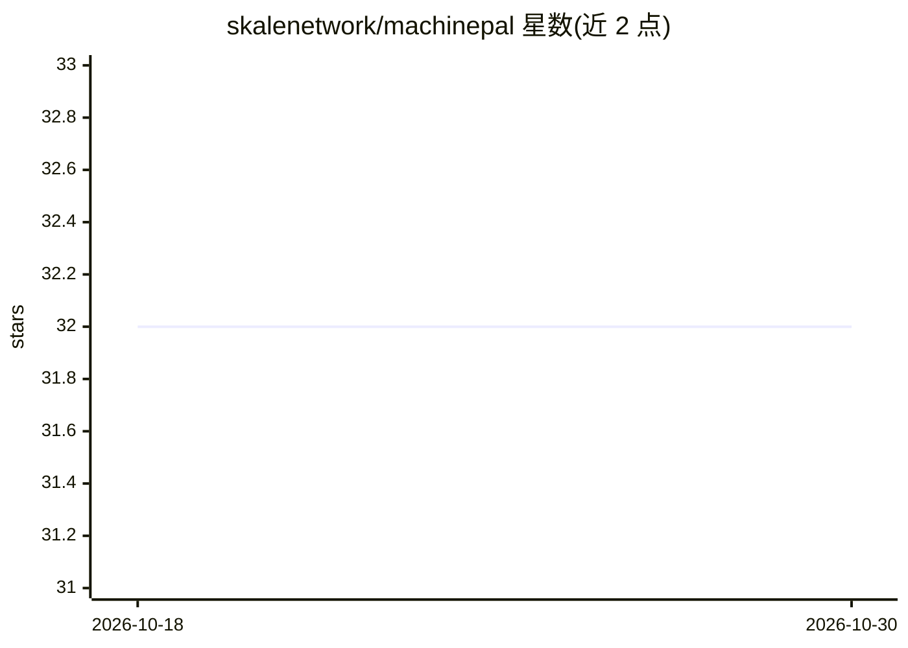

# skalenetwork/machinepal

⭐ 32 · C++ · MIT · 推送 2026-02-09 · [GitHub](https://github.com/skalenetwork/machinepal) · 组织维护

**给 AI 代理与 API 加 x402 付费墙的云原生网关**

MachinePal 是一个部署在 API、网站或 AI 代理前方的代理网关：请求先被拦截并返回 402 Payment Required，客户端通过 x402 协议（Coinbase 标准化）完成链上支付，网关验证交易后放行内容。面向想出售 API 访问而无需搭建 Stripe 或用户系统的开发者，以及需要代理自主买卖数据的 AI agent 场景。原生支持 Base 与 SKALE 网络，提供订阅、按次付费与计量三种计费模式，异步 HTTP 服务器声称可扩展至 1M+ 并发连接。以 Docker 镜像（ghcr.io）分发，含初始化、服务端与客户端示例命令。

## 筛选速览

| 维度 | 判定 | 备注 |
|---|---|---|
| AI 角色 | `ai-ecosystem` | LLM/agent 周边工具 |
| 许可风险 | `permissive` | MIT |
| 部署形态 | `self-host` | docker 或自建部署 |
| 模型依赖 | — | README 未给出锁定关系 |
| 硬件要求 | — | 无带数字的原话,不猜 |
| 安装摩擦 | `low` | 无编译、无系统依赖或容器化 |
| 成熟度 | — | 结构信号不足 |

## 能力要点

- 实现 x402 协议的支付协商、链上验证与访问放行
- 包装现有 API/站点，后端无需改代码
- 支持 Base 和 SKALE 网络，订阅/按次/计量计费
- 异步 HTTP 服务器，面向高并发低延迟环境

## 适用场景

- 为自己的 API 加上按次付费墙而无需用户系统
- 让 AI agent 以 x402 协议自主购买数据或服务
- 把静态文件服务器变为付费资源

## 场景标签

 · 领域:AI 基础设施/区块链支付

## 证据(README 行号)

> L6:  **Instantly monetize AI Agents.** *MachinePal is a drop-in cloud native gateway that adds MCP/x402 payments support
> L16: It implements the x402 protocol (standardized by Coinbase) to handle negotiation, payment verification, and access 

## 星数曲线

2026-10-18 32 → 2026-10-30 32（+0）

---
*卡片 v1 · prompt 1.4 · 生成 2026-10-26 · 置信度 high · 依据 README sha `db57f6c6be80` · [字段定义](../../DATASET.md)*
